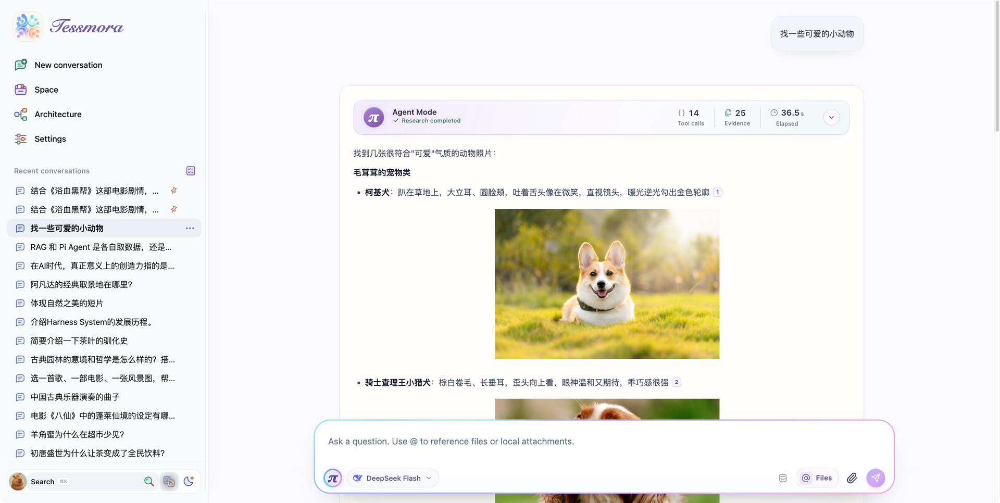
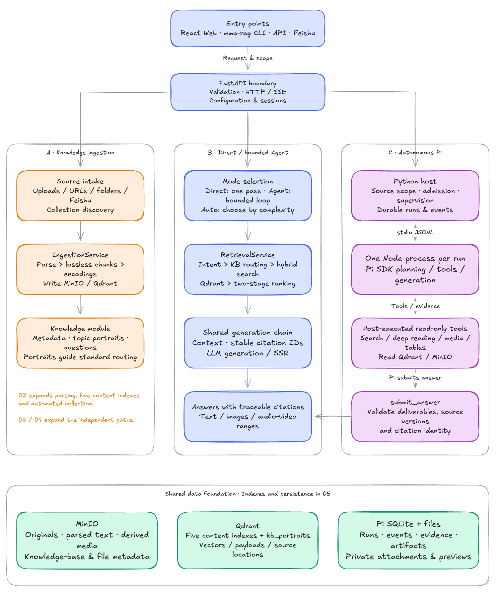

<h1 align="center">
  
</h1>

<p align="center">
  <a href="README.md">简体中文</a> · <strong>English</strong>
  <br />
  <a href="#features">Features</a> · <a href="#quick-start">Quick start</a> · <a href="#develop-from-source">Develop</a> · <a href="#api">API</a> · <a href="#architecture">Architecture</a> · <a href="#documentation">Docs</a>
</p>

<p align="center">
  <a href="https://github.com/Champ-X/MMA-RAG/actions/workflows/checks.yml"></a>
  
  
</p>

Tessmora is a self-hosted multimodal knowledge base. Upload documents, spreadsheets, images, audio, or video, search in natural language, and open a citation to reach the original passage, image, or clip.

<details open>
<summary>Watch the demo (4 min 36 sec)</summary>

https://github.com/user-attachments/assets/b3d5a990-115f-4508-a707-b99d2acc590e

[Watch with subtitles](https://xiangqingping.com/works/tessmora#tessmora-intro) · [Download the English MP4](docs/media/tessmora-intro/tessmora-intro-en.mp4?raw=1) · [English subtitles (SRT)](docs/media/tessmora-intro/en.srt)

</details>

## Features

- PDF, Office, Markdown, plain text, spreadsheets, images, audio, and video.
- Search document passages, individual images and audio files, or specific shots in a video.
- Standard chat offers Direct, Auto, and Agent modes. Pi can run follow-up searches, read sources, and perform calculations on tables.
- Choose knowledge bases or use **Select search files** to limit the search. Use `@` in the composer to add material to read or compare for this question.
- Web UI, retrieval API, knowledge-base CLI, and Feishu IM / Docx / Wiki integration.
- English and Simplified Chinese interface.

## Quick start

### Requirements

- Git
- Docker Engine or Docker Desktop
- Compose 2.20+
- Node.js 22.19+

The backend image includes Python, FFmpeg, and LibreOffice. For the text example below, have your DeepSeek and SiliconFlow API keys ready.

### Install

```bash
git clone --depth 1 --single-branch https://github.com/Champ-X/MMA-RAG.git
cd MMA-RAG
npm --prefix packages/cli ci
node packages/cli/bin/tessmora.js setup --source .
```

In the wizard, choose to run on this computer (`在这台电脑运行`), then select document Q&A (`文档问答`). Follow the prompts for the data directory, web port, and API keys. When prompted, open the workspace through the wizard to connect with this instance’s port and credential.

To reopen the workspace, run `node packages/cli/bin/tessmora.js open` from the repository root. On WSL or a headless host, use `node packages/cli/bin/tessmora.js open --print-url` and paste the link into your browser. The link contains the instance credential, so keep it private.

**Try a question with a citation**

1. Create a knowledge base, upload the [sample rollback runbook](evals/baseline_v1/corpus/ops-rollback.md), and wait for indexing to finish. The runbook is in Chinese.
2. Select that knowledge base in chat and ask in Direct mode, “When is a rollback required, and how do we verify it?”
3. Open the citation for the verification steps. The runbook calls for three consecutive successful `/ready` checks, followed by 15 minutes of monitoring the error rate and P95 latency.

| Instance management | Run from the repository root |
| --- | --- |
| Check services and model readiness | `node packages/cli/bin/tessmora.js status` |
| Stop the instance and keep its data | `node packages/cli/bin/tessmora.js stop` |
| Start an existing instance | `node packages/cli/bin/tessmora.js start` |

Originals and indexes live in the data directory you choose. Using cloud models can send questions and source material to the provider and incur charges. Read the [security policy](SECURITY-en.md) before sharing an instance. For upgrades, backups, and troubleshooting, see the [installer guide](packages/cli/README.md) and [container distribution](docs/DISTRIBUTION.md).

## Develop from source

On macOS, Linux, or WSL2, run the following commands from the repository root. You need Python 3.11 or 3.12, Node.js 22.19+, and Docker with Compose. If you use Python 3.11, replace `python3.12` in the first command with `python3.11`.

```bash
python3.12 -m venv .venv
source .venv/bin/activate
python -m pip install -r backend/requirements.txt
npm --prefix frontend ci
npm --prefix agent-runtime ci
cp -n backend/.env.example backend/.env
```

Set `DEEPSEEK_API_KEY` and `SILICONFLOW_API_KEY` in `backend/.env` for the default text models. Add `ALIYUN_BAILIAN_API_KEY` for the default image, audio, or video models, and clear unused placeholder keys. On the host, install FFmpeg (including ffprobe) for audio and video, and LibreOffice for Office conversion and previews.

```bash
./start-dev.sh
```

The default web address is <http://localhost:3001>. The launcher runs Vite and FastAPI on the host and starts or reuses MinIO, Qdrant, and Redis in Docker. Start a Celery worker separately if you need one during development. See [local startup](docs/LOCAL_STARTUP.md) for ports, background mode, and storage recovery.

## Usage

### Agent modes

| Mode | When to use it |
| --- | --- |
| Direct | One retrieval pass, then an answer. |
| Agent | Adds follow-up searches within a budget for questions that span several files. |
| Auto | Picks Direct or Agent based on the question. |
| Pi | Turn on `π` in the composer to search, read sources, inspect media, or work with tables. |

Pi uses the Durable runtime by default, which supports added instructions mid-run, clarification replies, and resuming eligible interrupted runs. Expand an answer to inspect tool calls and sources. See [Pi tools and configuration](docs/PI_AGENT_MODE.md).

### Screenshots

[](docs/images/current/knowledge-en.jpg)

[](docs/images/retrieval/image-search-en.jpg)

[](docs/images/retrieval/video-search-en.jpg)

More [interface screenshots](docs/images/current/README.md) and [retrieval examples](docs/images/retrieval/README.md).

## API

`POST /api/v1/retrieval/search` returns evidence and its sources. Use `modalities` to filter results by type (`doc`, `image`, `audio`, or `video`). Replace `KB_ID` with your knowledge-base ID. If you use a custom web port, replace `3001` in the examples as well.

```bash
curl -X POST http://localhost:3001/api/v1/retrieval/search \
  -H 'Content-Type: application/json' \
  -d '{"query":"When is rollback required?","knowledge_base_ids":["KB_ID"],"top_k":5,"language":"en-US"}'
```

- For standard chat, use `/api/chat/message` or stream the answer with `/api/chat/stream`.
- Create a Pi run at `/api/pi/runs`. Subscribe to the run’s events at its `/events` endpoint. Use `/inputs` to add instructions or answer a clarification.

When running from source, open the [FastAPI reference](http://localhost:8000/docs). The full Docker installation serves `/api/` and `/health` through the web port. Backend port `8000` is internal to the container network.

You can also use the knowledge-base CLI from the repository root. It runs with `python3` on the host. Use `kb list` to find the knowledge-base ID for these examples.

```bash
export MMA_RAG_BASE_URL=http://localhost:3001
skills/mma-rag/scripts/mma-rag health
skills/mma-rag/scripts/mma-rag kb list
skills/mma-rag/scripts/mma-rag search --query "When is rollback required?" --kb-id KB_ID
skills/mma-rag/scripts/mma-rag ask --query "Summarize the rollback procedure" --kb-id KB_ID --agent-mode auto
```

`ask --agent-mode` accepts `direct`, `auto`, or `agent`. See the [knowledge-base CLI reference](skills/mma-rag/references/cli-reference.md) for the full command list.

## Architecture

In the full Docker installation, Nginx serves the frontend, FastAPI handles API requests, and Pi runs research tasks in separate Node processes. MinIO stores originals and derived files, and Qdrant holds retrieval indexes. Redis tracks upload progress. A Celery worker handles background jobs such as updating knowledge-base profiles.

[](docs/diagrams/mma-rag/overview-en.png)

This diagram shows the architecture on November 5, 2026. The [architecture guide](docs/MMA_ARCHITECTURE.md) covers the current retrieval flow and Pi task recovery.

- [Multimodal parsing and retrieval](docs/MULTIMODAL_IMAGE_AUDIO_VIDEO_TECHNICAL_SPEC.md)
- [Module diagrams and editable sources](docs/diagrams/mma-rag/readme-modules/README.md)

## Documentation

Find guides by task in the [documentation index](docs/README-en.md).

| Topic | Docs |
| --- | --- |
| Install, upgrade, back up | [Installer CLI](packages/cli/README.md) · [Container distribution](docs/DISTRIBUTION.md) |
| Configure models and language | [Model call troubleshooting](docs/MODEL_CALL_RELIABILITY.md) · [Localization](docs/ENGLISH_SUPPORT.md) |
| Feishu and web import | [Feishu setup](docs/FEISHU_BOT_SETUP.md) · [Web collection](docs/NETWORK_COLLECTION.md) |
| Evaluation | [RAG baseline](docs/RAG_EVALUATION.md) · [Retrieval evaluation](docs/RETRIEVAL_EVALUATION_V2.md) |
| Contributing | [Contributing guide](CONTRIBUTING-en.md) · [Security policy](SECURITY-en.md) |
| History | [Changelog](CHANGELOG.md) |
