<h1 align="center">
  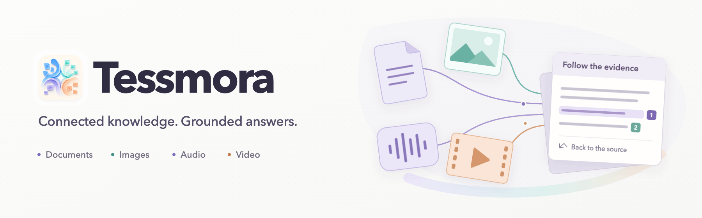
</h1>

<p align="center">
  <a href="README.md">简体中文</a> · <strong>English</strong>
  <br />
  <a href="#demo">Intro video</a> · <a href="#in-action">In action</a> · <a href="#quick-start">Quick start</a> · <a href="#agent-mode">Agent Mode</a> · <a href="#architecture">Architecture</a> · <a href="#documentation">Docs</a>
</p>

<p align="center">
  <a href="https://github.com/Champ-X/MMA-RAG/actions/workflows/checks.yml"></a>
  
  
</p>

**Tessmora is a self-hosted multimodal knowledge base and agent research workspace.** Bring documents, spreadsheets, images, audio, and video together. Search, compare, and ask questions in natural language, then follow citations back to source text, images, or media segments.

Explore research materials, find visuals and music, or let Pi investigate a question through search, close reading, and evidence gathering. The Web UI supports Simplified Chinese and English; the repository retains the name `MMA-RAG`.

## Demo

https://github.com/user-attachments/assets/b3d5a990-115f-4508-a707-b99d2acc590e

**English introduction** · 4 min 36 sec · 720p · Plays inline on GitHub

[English MP4](docs/media/tessmora-intro/tessmora-intro-en.mp4?raw=1) · [中文 MP4](docs/media/tessmora-intro/tessmora-intro-zh.mp4?raw=1) · [English subtitles](docs/media/tessmora-intro/en.srt) · [About the media files](docs/media/tessmora-intro/README.md)

## What you can do

| Workflow | Capabilities |
| --- | --- |
| **Collect and organize materials** | Upload local files or discover materials through public URLs and configured web sources; preview candidates before importing them and track downloading, parsing, and indexing |
| **Search across modalities** | Combine Dense, BGE-M3 Sparse, CLIP, and CLAP retrieval channels with intent-aware fusion and reranking; route queries by topic profiles when no knowledge base is selected |
| **Investigate a question** | Let Pi search, read paginated source text, expand context, inspect media, and calculate over tables; add instructions during a run or answer a clarification to continue the task |
| **Check the sources** | Follow citations to original files, text context, images, and audio/video time ranges; inspect actual tool calls, evidence, timing, and errors in the trace panel |
| **Control materials and scope** | Reference files or local attachments with `@`, and constrain search with knowledge-base and file selectors; referencing a material does not automatically expand search scope |
| **Connect your workflow** | Use the bilingual Web UI, retrieval and chat APIs, installation CLI, knowledge-base CLI / Codex Skill, and optional Feishu IM and Docx/Wiki import |

## In action

Organize your materials, find a visual, audition music, or locate a moment in a video. The retrieval examples come from existing conversations in the running application; click an image for the full view. The English UI retains the original Chinese queries and source content. [Screenshot and example notes](docs/images/retrieval/README.md).

### One space for different kinds of material

Organize documents, images, audio, and video by topic, with content types and counts visible at a glance.

[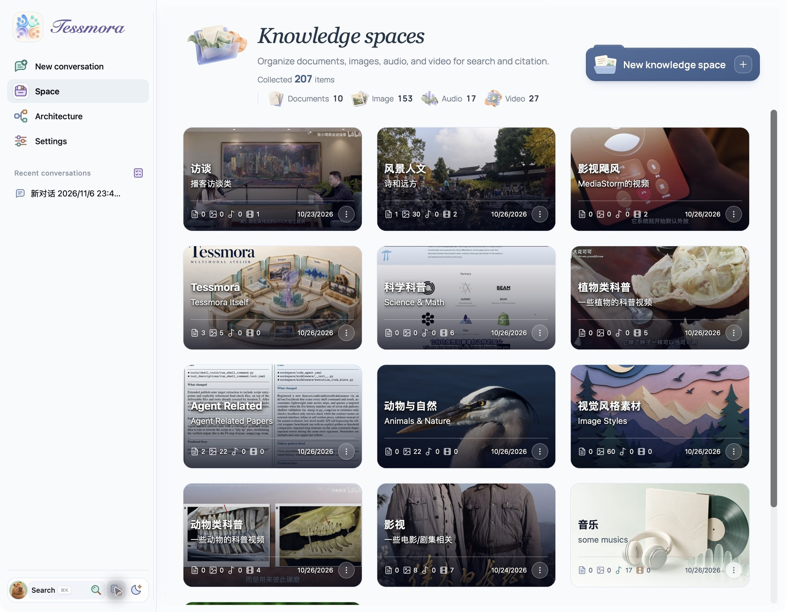](docs/images/current/knowledge-en.jpg)

### Describe a scene, find an image, follow its source

Describe the visual you need in natural language and see images directly in the answer. Open a citation to compare the original image and its description beside the response.

[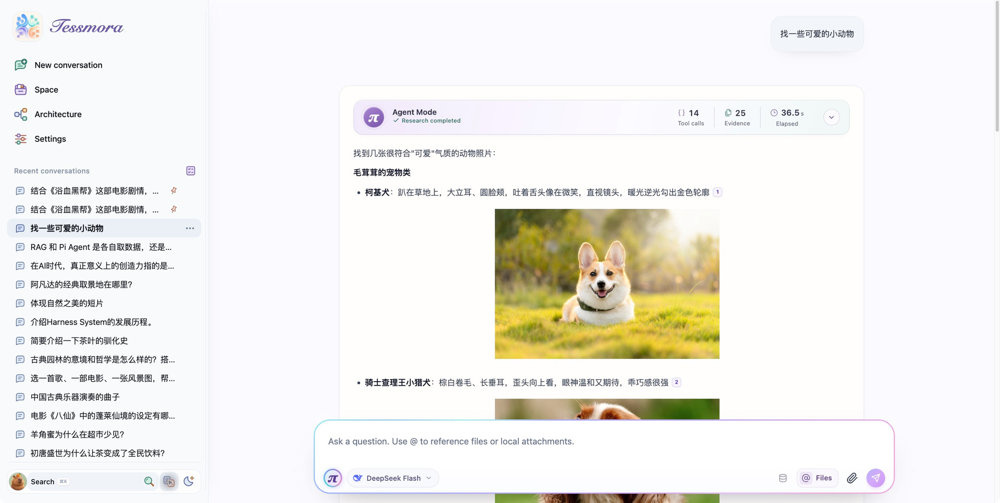](docs/images/retrieval/image-search-en.jpg)

### Describe a sound and listen in the answer

An existing request for Chinese instrumental music returns tracks such as “水墨兰亭” and “紫竹调”. Compare sound descriptions, then audition each result with the embedded player.

[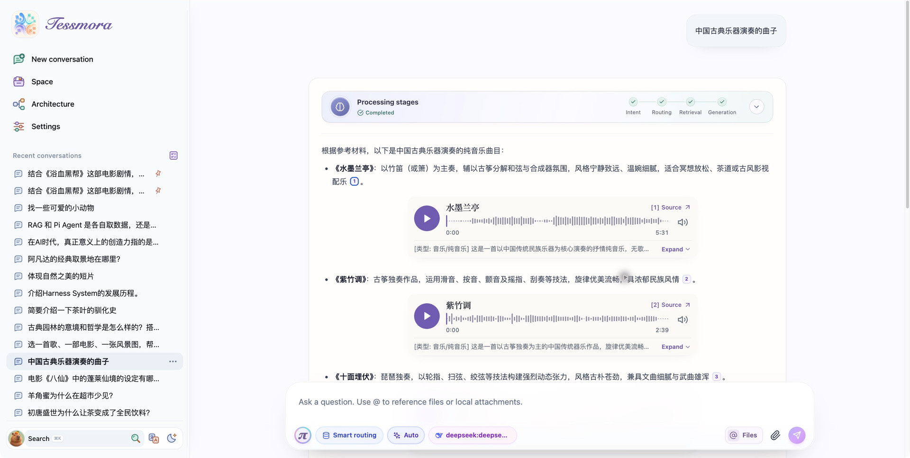](docs/images/retrieval/audio-search-en.jpg)

### Turn a question into a moment in a video

An existing request for nature shorts retrieves forest and canyon scenes. Follow a citation to its time range, keeping the description and original segment together for review.

[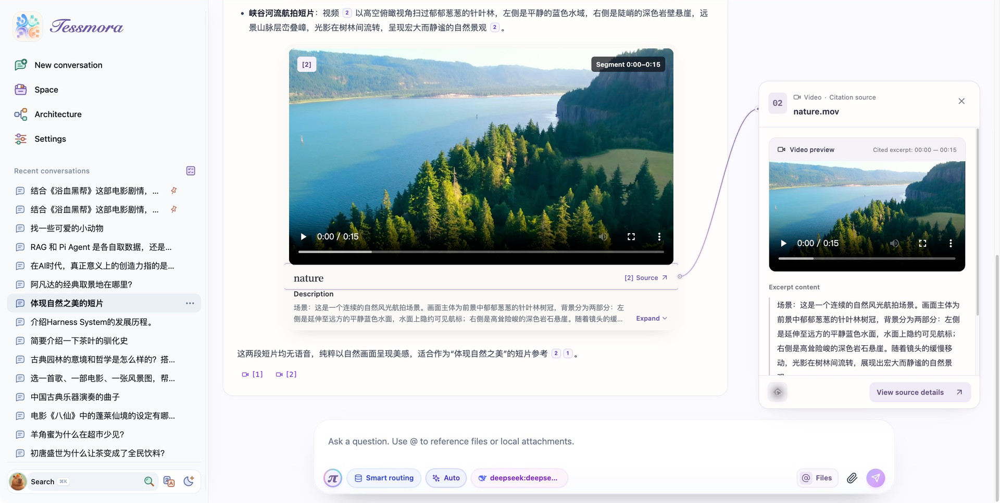](docs/images/retrieval/video-search-en.jpg)

<details>
<summary><strong>More views: file gallery and document citations</strong></summary>

**File gallery** — Browse documents and images together, filter by type, and open previews or index details.

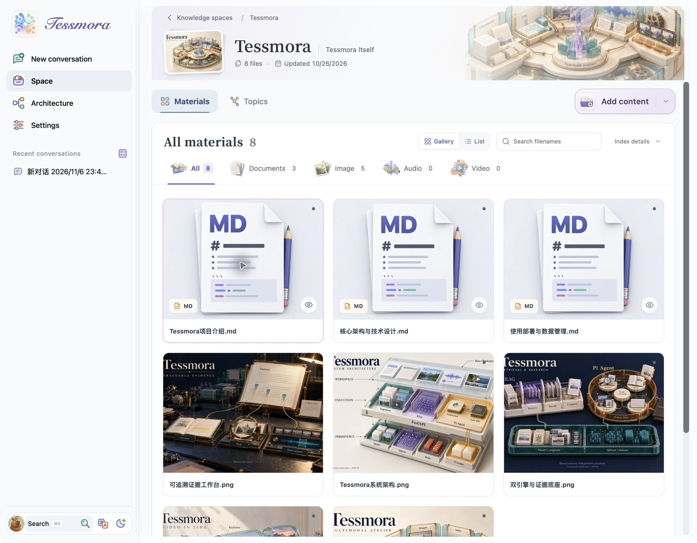

**Read the answer beside its source** — Open cited text in the source panel while keeping the claim, citation, and supporting image connected.

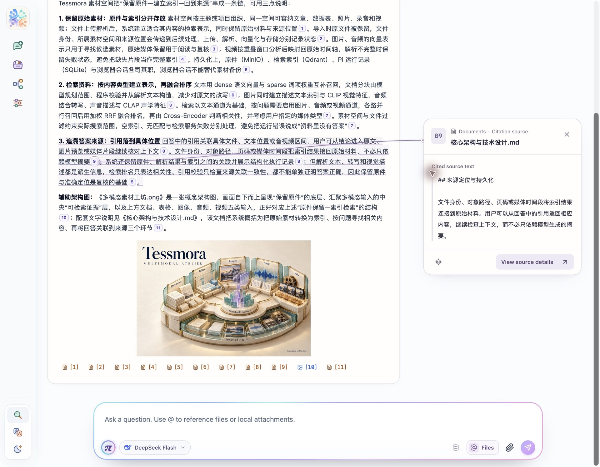

These project-material captures were taken on November 6–7, 2026; example documents may predate the current implementation. See the [original screenshot notes](docs/images/current/README.md).

</details>

## Quick start

### Install locally

For a first installation, use the **terminal wizard and complete Docker runtime**. You need Node.js **22.19+**, Docker, and Compose **2.20+**. The containers provide application dependencies such as Python and FFmpeg. If Docker is not ready, the wizard provides installation links and steps to check again. The installer currently runs primarily in Chinese.

```bash
git clone --depth 1 --single-branch https://github.com/Champ-X/MMA-RAG.git
cd MMA-RAG
npm --prefix packages/cli ci
node packages/cli/bin/tessmora.js setup --source .
```

The wizard walks through capabilities, data location, and model providers, builds and starts the application and storage, tests model connections, and prepares the local models you need. The default Web address is [http://localhost:3001](http://localhost:3001); use the page opened by the wizard to connect your workspace. Choose another port if needed. If setup is interrupted, run the same command again to continue.

For an initial Markdown / TXT question, select text capabilities and configure DeepSeek and SiliconFlow. The default image, audio, and video capabilities also require Alibaba Cloud Bailian. The first build and model downloads take time, disk space, and memory; the wizard displays progress and logs.

**Data and models:** Original files, indexes, and run records are stored in the selected data directory. Default parsing and inference call your configured model providers, which may receive content and charge for usage. Self-hosting does not imply offline inference. The application currently targets a local single-user workspace or trusted network; read the [security policy](SECURITY-en.md) before exposing it publicly.

<details>
<summary>Daily management, command registration, and opening the app from WSL</summary>

```bash
node packages/cli/bin/tessmora.js status
node packages/cli/bin/tessmora.js stop
node packages/cli/bin/tessmora.js start
node packages/cli/bin/tessmora.js doctor
```

Run `npm --prefix packages/cli run register-command` to register the `tessmora` command, then verify it with `tessmora --version`. Until registration and PATH configuration are complete, use the Node entry point above.

If WSL or a headless environment cannot open a browser automatically, run `node packages/cli/bin/tessmora.js open --print-url` and paste the complete URL into your browser. The link contains this instance's connection credential and is for your own use only.

This guide uses a source build. See the [installer guide](packages/cli/README.md) and [container distribution guide](docs/DISTRIBUTION.md) for packaged installation, configuration changes, remote connections, and complete data backups.

</details>

### Get your first cited answer

1. Open the Web UI and create a knowledge base.
2. Upload your own document, or use the synthetic Chinese example [`ops-rollback.md`](evals/baseline_v1/corpus/ops-rollback.md). Wait for processing to finish.
3. Select that knowledge base and use Direct retrieval to ask: **“When is rollback required, and how should it be verified?”** The equivalent question in the sample's language is “什么情况下必须回滚？回滚后如何验证？”
4. Open the citations and check the source's trigger conditions, three `/ready` checks, and 15-minute observation period.
5. Toggle `π` on the left of the composer to try deeper research, then expand the trace to see which sources and tools it used.

An API health check only confirms that the service has started. Complete an upload, retrieval, and citation check to verify the path you intend to use.

### Develop from source

Run the frontend and backend locally, with storage in Docker. The commands below target macOS / Linux; Windows users can use WSL2.

<details>
<summary><strong>Expand development prerequisites, model configuration, and startup commands</strong></summary>

You need Python **3.11 / 3.12**, Node.js **≥22.19**, and Docker / Compose. Audio/video processing requires **FFmpeg / ffprobe**. DOCX/PPTX conversion and previews require **LibreOffice**; install `fonts-noto-cjk` for Chinese documents on Linux.

From the root of the cloned repository:

```bash
cp backend/.env.example backend/.env
```

Edit `backend/.env` with your credentials and clear the `your_...` placeholders for unused services. The current default routes use:

| Environment variable | Purpose |
| --- | --- |
| `DEEPSEEK_API_KEY` | Text answers, intent recognition, document chunking, and the Pi main model: `deepseek-flash` |
| `SILICONFLOW_API_KEY` | Text embeddings and reranking: Qwen3 Embedding / Reranker |
| `ALIYUN_BAILIAN_API_KEY` | Image understanding, audio transcription, video parsing, and Pi media inspection |
| `MINERU_TOKEN` | Optional MinerU cloud document parsing; other parsing paths depend on file type and installed dependencies |
| `OPENROUTER_API_KEY` | Optional; used when selecting OpenRouter models |

Standard model routes can be changed in settings. Pi uses [separate configuration](docs/PI_AGENT_MODE.md). See the [environment example](backend/.env.example) for optional services such as web collection and Feishu.

```bash
python3.12 -m venv .venv
source .venv/bin/activate
python -m pip install --upgrade pip
python -m pip install -r backend/requirements.txt
npm --prefix frontend ci
npm --prefix agent-runtime ci
./start-dev.sh
```

Replace the Python version in the first line if using 3.11. The script prefers `.venv` (or `MMA_PYTHON`), checks runtimes and dependencies, starts or reuses MinIO / Qdrant / Redis from the root Compose file, and waits for the API and frontend proxy to be ready. Celery workers and Flower are not part of this startup path. The complete container installation uses the separate `deploy/compose.yaml`.

The example configuration enables local model preloading, which may download BGE-M3, CLIP, and CLAP on first startup. Set `PRELOAD_LOCAL_MODELS_ON_STARTUP=false` to defer loading until first use; this does not remove those dependencies.

```bash
./start-dev.sh                       # foreground; Ctrl+C stops the frontend and backend
./start-dev.sh restart --background  # restart and run in the background
./start-dev.sh status                # processes, API health, and frontend proxy
./start-dev.sh logs                  # recent logs
./start-dev.sh stop                  # stop the app; retain storage containers
./start-dev.sh doctor                # check the environment only
```

| Source development entry point | Default URL |
| --- | --- |
| Web UI | [localhost:3001](http://localhost:3001) |
| API / OpenAPI | [localhost:8000/docs](http://localhost:8000/docs) |
| Health check | [localhost:8000/health](http://localhost:8000/health) |
| MinIO Console | [localhost:9001](http://localhost:9001) |
| Qdrant Dashboard | [localhost:6333/dashboard](http://localhost:6333/dashboard) |

The frontend defaults to 3001, configurable with `--port` / `FRONTEND_PORT`; the backend is fixed at 8000. Add `--reload` for backend development. See the [local startup guide](docs/LOCAL_STARTUP.md) for port conflicts, model downloads, media access, and restoring existing data.

</details>

## Agent Mode

Switch between two independent answering paths within a conversation:

| Path | Best suited to | How it works |
| --- | --- | --- |
| **Standard retrieval** | Finding materials quickly and asking questions within a known scope | `direct` retrieves once; `agent` gathers more evidence within round, query, and evidence budgets; `auto` chooses between them |
| **Pi Agent** | Research that requires repeated search, close reading, comparison, and media inspection | An independent Pi loop selects tools, maintains a research plan, gathers evidence, and submits a cited answer; enable it with `π` in the Web composer |

Pi can read long documents, expand adjacent passages, recall evidence, inspect images/PDF pages/audio/video segments, and perform deterministic filtering, grouping, and calculations on CSV/TSV/XLSX files. It reuses knowledge data with its own search orchestration and can add native CLIP image / CLAP audio retrieval as needed. Web collection is a separate ingestion feature; Pi's source tools do not expose arbitrary shell commands, code execution, or automatic web crawling.

**Research can continue.** The default Pi Durable runtime saves tasks, events, and evidence. It supports additional instructions during a run, clarification replies at `needs_input`, event reconnection after a page refresh, and recovery of eligible unfinished tasks after a service restart. Explicitly stopping a task or deleting its conversation cancels it. Changes to the model, materials, or search scope require a new task. The `core` compatibility mode does not offer the same execution recovery.

**The limits are visible.** Pi has no application-level cap on cumulative duration, tokens, or total tool calls. You can stop a run, and no-progress and error guards still terminate execution. Recovering an interrupted model request may incur additional charges. Citation checks validate source identity and numbering, not semantic correctness; video inspection uses sampling rather than observing every frame.

**Open the research process.** Inspect a task's tool calls, evidence, and execution record to see how search and reading support the answer.

[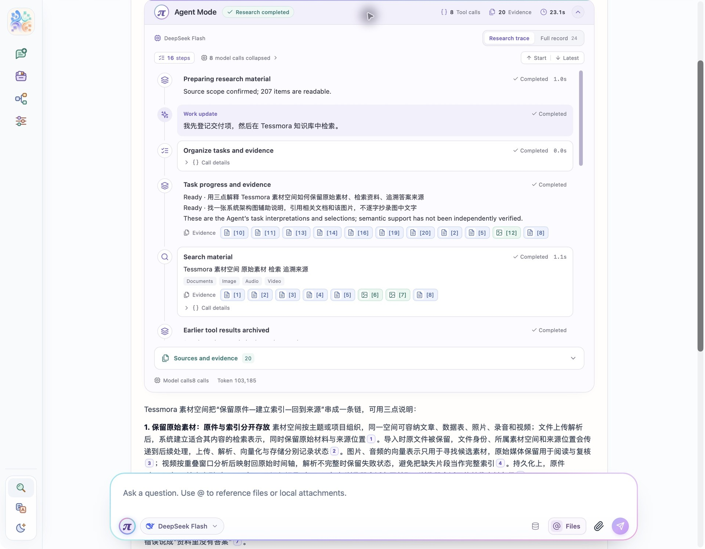](docs/images/current/trace-en.jpg)

[Tools and configuration](docs/PI_AGENT_MODE.md) · [Durable recovery, ongoing input, and known limitations](docs/pi-agent-durable.md)

## Architecture

Follow three paths through Tessmora: **how materials are indexed, how a question finds evidence, and how Pi carries out research.** These diagrams are checked against the current code and include editable Excalidraw files. See the [architecture guide](docs/MMA_ARCHITECTURE.md) for detailed responsibilities and boundaries.

### 01 · Multimodal ingestion: keep originals, index their sources

Documents and tables retain their structure; images, audio, and video receive modality-specific search representations. MinIO stores originals and derived media, while Qdrant stores vectors, indexes, and source locations. Knowledge-base profiles support later routing.

[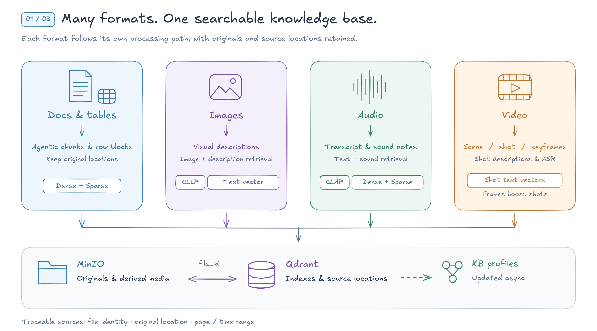](docs/diagrams/mma-rag/readme-modules/ingestion-en.png)

[Edit this diagram](docs/diagrams/mma-rag/readme-modules/ingestion-en.excalidraw)

### 02 · Hybrid retrieval: from a question to inspectable evidence

Interpret the question and scope, then retrieve text, image, and audio/video candidates as needed. Fusion and reranking feed an answer with citations, linking each source back to text, an image, or a media time range.

[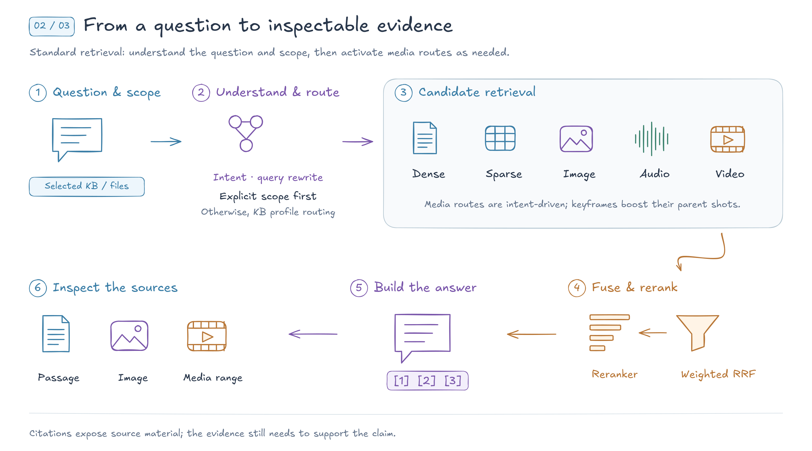](docs/diagrams/mma-rag/readme-modules/retrieval-en.png)

[Edit this diagram](docs/diagrams/mma-rag/readme-modules/retrieval-en.excalidraw)

### 03 · Pi Durable: preserve the research and its evidence

Pi chooses search, reading, media inspection, and table tools within the source scope enforced by its host. The run ledger supports instructions during research, replies to clarification requests, and eligible recovery after interruption. This research path is independent of standard retrieval.

[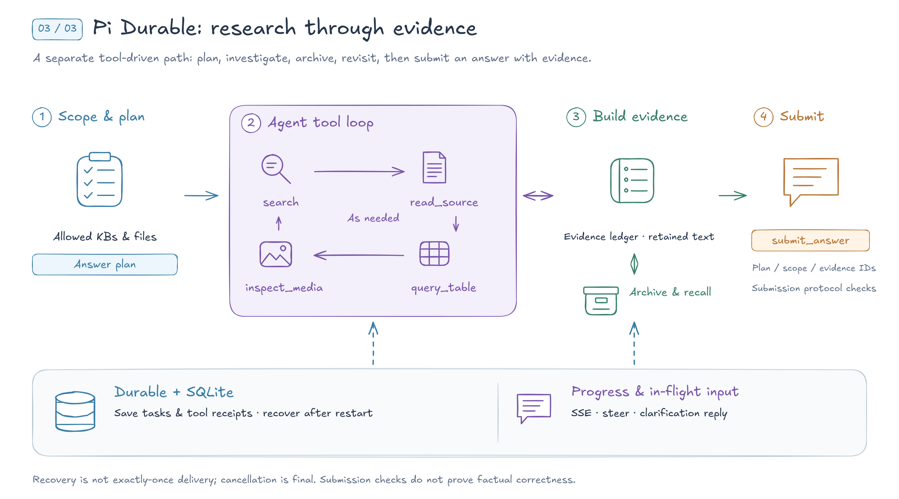](docs/diagrams/mma-rag/readme-modules/pi-durable-en.png)

[Edit this diagram](docs/diagrams/mma-rag/readme-modules/pi-durable-en.excalidraw) · [Bilingual modules and code references](docs/diagrams/mma-rag/readme-modules/README.md)

<details>
<summary>Earlier single-canvas overview and source directories</summary>

[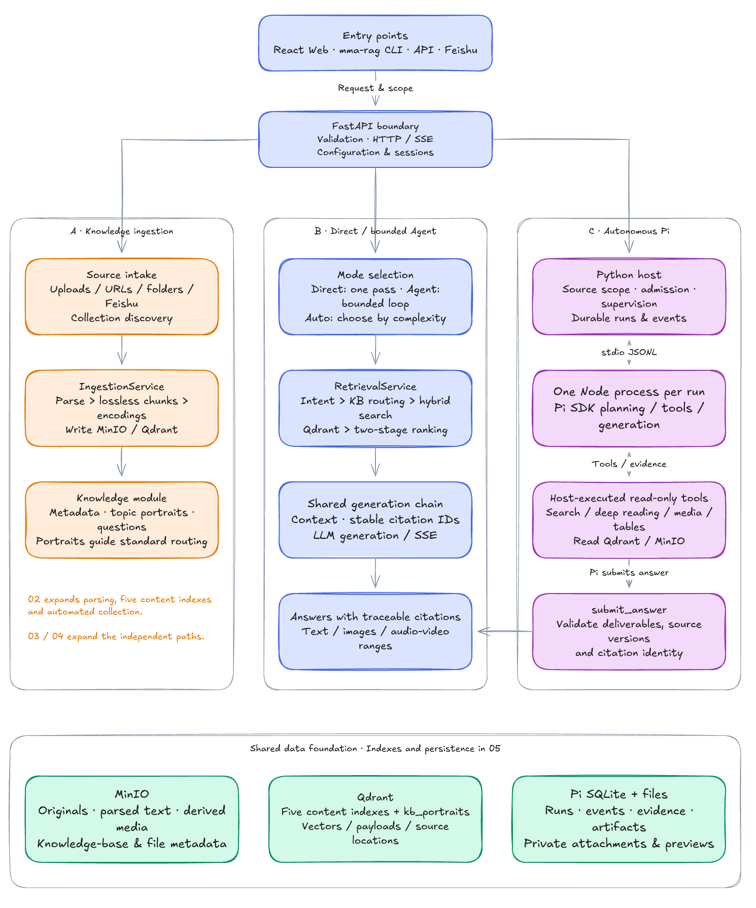](docs/diagrams/mma-rag/MMA-RAG-en-handwritten.svg)

[Full English overview](docs/diagrams/mma-rag/MMA-RAG-en-handwritten.svg) · [Editable Excalidraw](docs/diagrams/mma-rag/MMA-RAG-en.excalidraw) · [Original diagram collection](docs/diagrams/mma-rag/README.md)

This overview dates to **November 5, 2026 / `658b0d1`**. Its Pi restart and native media retrieval descriptions predate later updates; the module diagrams above and current code describe today's behavior.

| Source directory | Responsibility |
| --- | --- |
| [`frontend/`](frontend/) | Knowledge bases, chat, media citations, research traces, and the bilingual UI |
| [`ingestion/`](backend/app/modules/ingestion/) · [`collection/`](backend/app/modules/collection/) | File parsing, multimodal indexes, and web material collection |
| [`retrieval/`](backend/app/modules/retrieval/) · [`agent/`](backend/app/modules/agent/) · [`generation/`](backend/app/modules/generation/) | Standard retrieval, bounded multi-round evidence gathering, and answer generation |
| [`pi_agent/`](backend/app/modules/pi_agent/) · [`agent-runtime/`](agent-runtime/) | Pi host, source tools, run ledger, and Durable loop |
| [`core/llm/`](backend/app/core/llm/) · [`packages/cli/`](packages/cli/) | Model providers and task routing, installation, and instance management |

</details>

## API and integrations

Use the read-only retrieval API to obtain `doc | image | audio | video` evidence. Replace `KB_ID` with a real knowledge-base ID. This example uses the Web proxy available in both installation paths; adjust the port to your configuration:

```bash
curl -X POST http://localhost:3001/api/v1/retrieval/search \
  -H 'Content-Type: application/json' \
  -d '{"query":"When is rollback required?","knowledge_base_ids":["KB_ID"],"top_k":5,"language":"en-US"}'
```

Standard chat uses `/api/chat/message` or `/api/chat/stream`. Pi creates tasks through `/api/pi/runs`, streams progress through `/api/pi/runs/{run_id}/events`, and accepts additional input at `/api/pi/runs/{run_id}/inputs`. Pi has separate access controls; see the [Pi guide](docs/PI_AGENT_MODE.md). Source development also exposes port 8000 directly and [OpenAPI](http://localhost:8000/docs) for request schemas. The complete Docker installation does not publish port 8000 or the OpenAPI page by default.

`tessmora` manages installation and services; the bundled **`mma-rag`** CLI operates on knowledge bases, retrieval, and chat. The latter requires Python on the host. Run it directly, or install it as a Codex Skill with `./scripts/install-codex-skill.sh`:

```bash
export MMA_RAG_BASE_URL=http://localhost:8000 # source development; use http://localhost:3001 for the complete Docker installation
skills/mma-rag/scripts/mma-rag health
skills/mma-rag/scripts/mma-rag kb list
skills/mma-rag/scripts/mma-rag search --query "When is rollback required?" --kb-id KB_ID
skills/mma-rag/scripts/mma-rag ask --query "Summarize the rollback procedure" --kb-id KB_ID --agent-mode auto
```

The CLI's `--agent-mode` selects standard `direct / auto / agent` behavior, not Pi. Feishu IM currently uses Direct retrieval. See the [CLI reference](skills/mma-rag/references/cli-reference.md) and [Feishu setup guide](docs/FEISHU_BOT_SETUP.md).

## Development and verification

After installing development dependencies, run from the repository root:

```bash
python3 scripts/check_repository.py
python3 scripts/test_dev.py
npm --prefix frontend test
npm --prefix frontend run test:dom
npm --prefix frontend run build
npm --prefix agent-runtime test
npm --prefix packages/cli test
./scripts/rag-eval validate
```

CI covers repository rules, the startup controller, frontend tests/build, and Pi and installer regressions. See [Contributing](CONTRIBUTING-en.md) for the services required by backend tests. Real model, corpus, and browser acceptance checks must be run separately; a build or health check does not replace them.

The quick evaluation uses **7 synthetic documents / 8 questions** for regression checks, not as a general quality benchmark. Tools for public corpora, your own knowledge bases, and Pi comparisons are covered in [RAG evaluation](docs/RAG_EVALUATION.md), [retrieval evaluation](docs/RETRIEVAL_EVALUATION_V2.md), and [Pi evaluation limits](docs/pi-agent-durable.md#对比评测与已知问题).

## Deployment boundaries

- **Single user and trusted networks:** The application does not yet provide complete user authentication, tenant isolation, or knowledge-base ACLs. Standard API CORS allows all origins. Pi / installer tokens do not replace application-wide authorization; public access requires additional protection. See [SECURITY-en.md](SECURITY-en.md).
- **Single writer and backups:** Only one host may hold the lock on a Pi data directory; back up the complete runtime directory. Standard backend sessions and some statistics remain in process memory, so the application cannot simply be scaled into stateless replicas.
- **Capabilities and quality:** Upstream Pi Durable is still Experimental. Pi does not currently support a native video-vector retrieval channel or include a semantic entailment verifier. Check media samples, retrieval results, and model conclusions against the original files.

## Documentation

Technical guides are currently maintained mostly in Chinese. Both READMEs cover the same product scope and installation paths.

| I want to… | Read |
| --- | --- |
| Install, upgrade, back up, or troubleshoot startup | [Installer](packages/cli/README.md) · [Container distribution](docs/DISTRIBUTION.md) · [Local startup](docs/LOCAL_STARTUP.md) |
| Understand the architecture and multimodal processing | [System architecture](docs/MMA_ARCHITECTURE.md) · [Multimodal technical guide](docs/MULTIMODAL_IMAGE_AUDIO_VIDEO_TECHNICAL_SPEC.md) · [Handwritten diagrams](docs/diagrams/mma-rag/README.md) |
| Configure Pi, recover tasks, or check execution limits | [Pi Agent](docs/PI_AGENT_MODE.md) · [Pi Durable](docs/pi-agent-durable.md) · [Decision models](docs/DECISION_MODELS.md) |
| Adjust language, models, and attachment behavior | [English support](docs/ENGLISH_SUPPORT.md) · [Model troubleshooting](docs/MODEL_CALL_RELIABILITY.md) · [References and attachments](docs/chat-inline-references.md) |
| Find other resources | [Documentation index](docs/README.md) · [Changelog](CHANGELOG.md) · [Repository maintenance](docs/REPOSITORY.md) |
