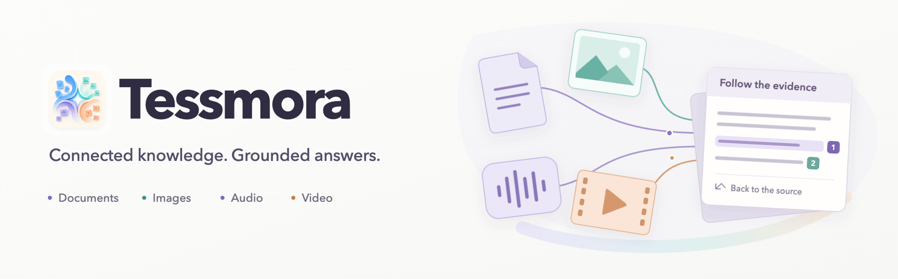
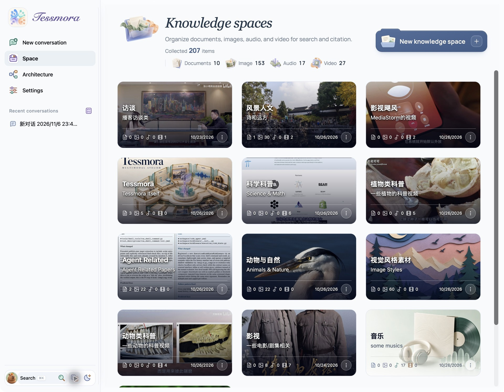
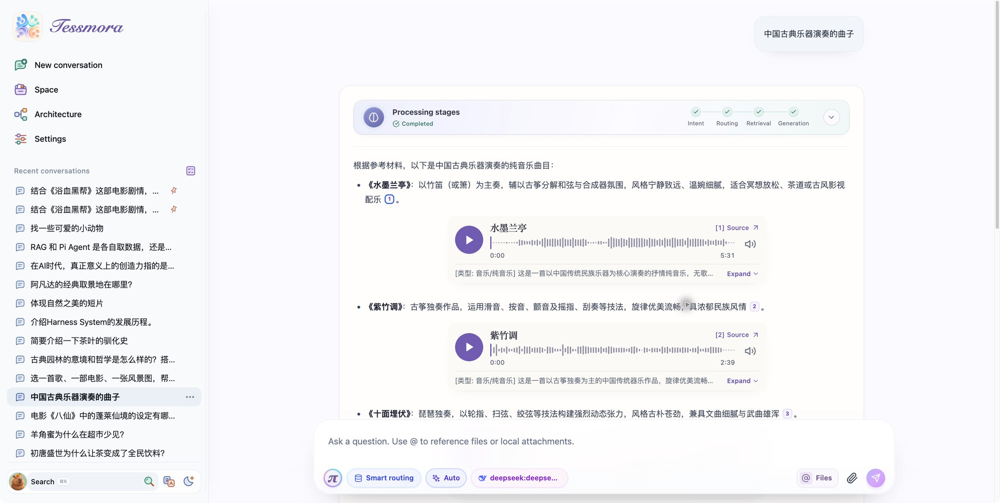
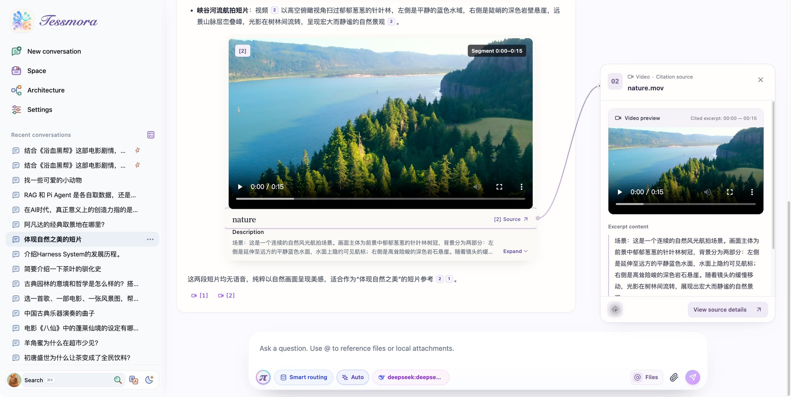
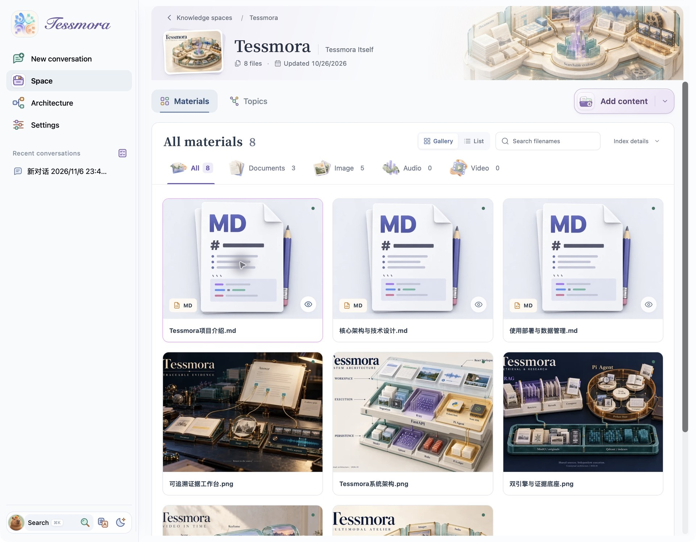
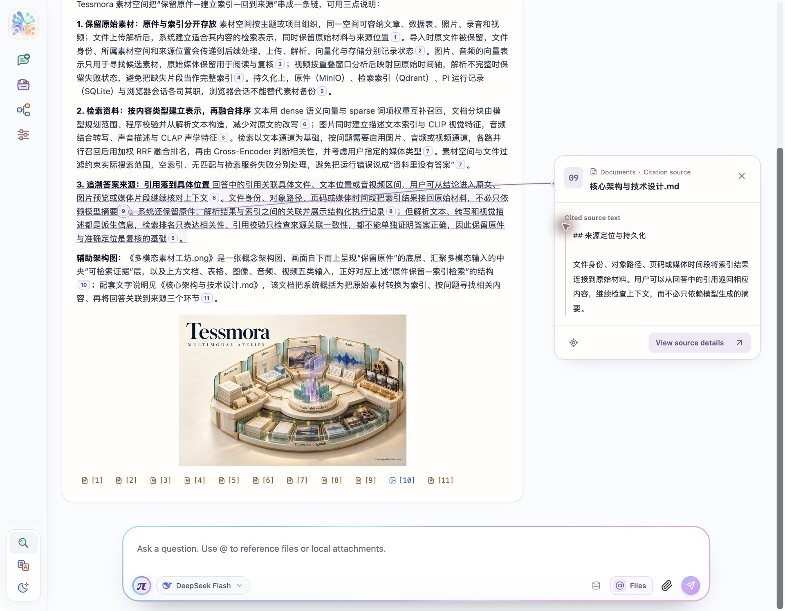
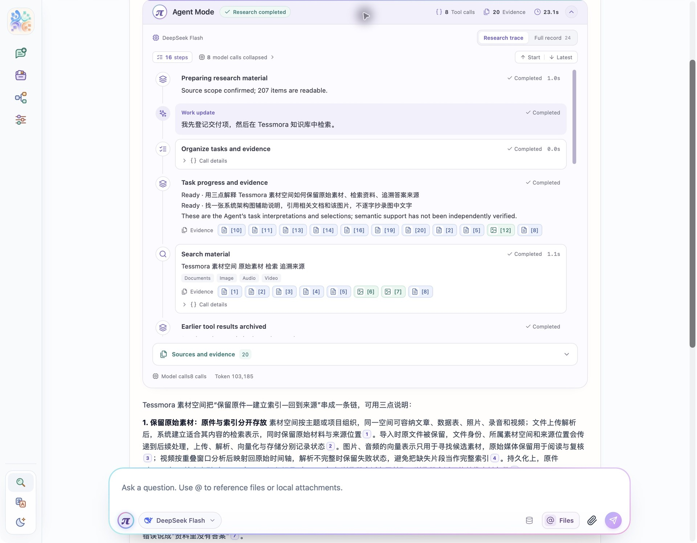
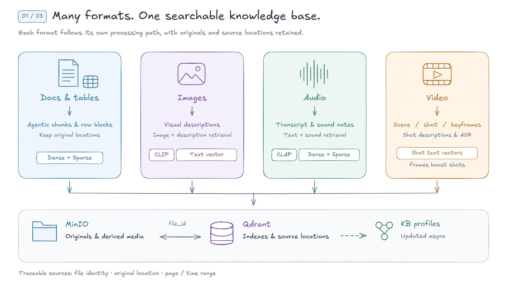
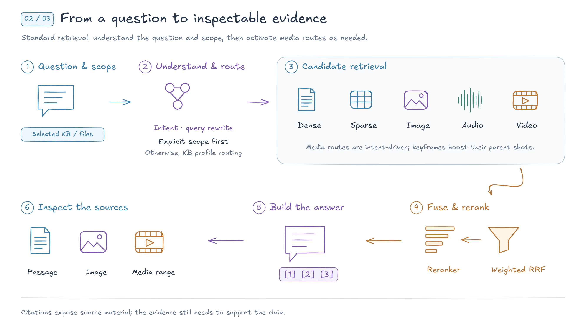
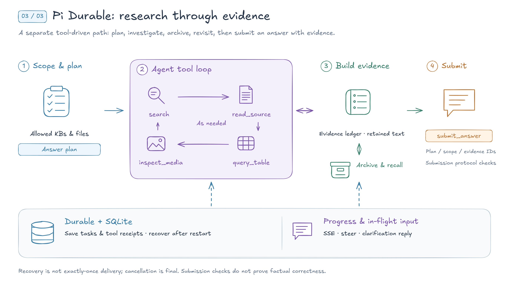

<h1 align="center">
  
</h1>

<p align="center">
  <a href="README.md">简体中文</a> · <strong>English</strong>
  <br />
  <a href="#demo">Intro video</a> · <a href="#in-action">In action</a> · <a href="#quick-start">Quick start</a> · <a href="#agent-mode">Agent Mode</a> · <a href="#architecture">Architecture</a> · <a href="#documentation">Docs</a>
</p>

<p align="center">
  <a href="https://github.com/Champ-X/MMA-RAG/actions/workflows/checks.yml"></a>
  
  
</p>

**Tessmora is a self-hosted knowledge base for documents, spreadsheets, images, audio, and video.** Search in natural language and open a citation to read the source, inspect an image, or play the matching clip. For questions that span several files, Pi can search and read further. The interface is available in English and Simplified Chinese.

## Quick start

For a local installation, you need Git, Node.js 22.19 or later, Docker, and Compose 2.20 or later. The application image includes Python, FFmpeg, and LibreOffice.

```bash
git clone --depth 1 --single-branch https://github.com/Champ-X/MMA-RAG.git
cd MMA-RAG
npm --prefix packages/cli ci
node packages/cli/bin/tessmora.js setup --source .
```

Choose a data directory and the capabilities you need. To try Markdown or plain-text questions, select text and supply DeepSeek and SiliconFlow credentials. The default image, audio, and video routes also use Aliyun Bailian. The wizard tests the selected models, downloads local weights as needed, and opens the workspace. The default web port is `3001`.

**Try a question with a citation**

1. Create a knowledge base, upload the [sample rollback runbook](evals/baseline_v1/corpus/ops-rollback.md), and wait for processing to finish. The sample is in Chinese.
2. Select that knowledge base and ask in Direct mode, “When is a rollback required, and how do I verify it?”
3. Open the citation. The runbook calls for three consecutive successful `/ready` checks, followed by 15 minutes of monitoring the error rate and P95 latency.

Use `node packages/cli/bin/tessmora.js status`, `stop`, or `start` to manage the instance. On WSL or a headless host, run `node packages/cli/bin/tessmora.js open --print-url` and paste the link into your own browser. It contains the instance credential. For the global `tessmora` command, setup recovery, upgrades, and backups, see the [installer guide](packages/cli/README.md) and [container guide](docs/DISTRIBUTION.md).

Originals and indexes live in the data directory you selected. Cloud model requests send the relevant questions and source material to the configured providers and may incur charges. The default installation serves one local user. Read the [security policy](SECURITY-en.md) before sharing an instance.

### Develop from source

To work on the frontend or backend, run the following from the repository root on macOS, Linux, or WSL2. Install Python 3.11 or 3.12, Node.js 22.19+, and Docker. Media processing uses FFmpeg/ffprobe, and Office conversion and previews use LibreOffice.

```bash
python3.12 -m venv .venv
source .venv/bin/activate
python -m pip install -r backend/requirements.txt
npm --prefix frontend ci
npm --prefix agent-runtime ci
cp -n backend/.env.example backend/.env
```

Use `python3.11` in the first line for Python 3.11. Edit `backend/.env` to set `DEEPSEEK_API_KEY`, `SILICONFLOW_API_KEY`, and `ALIYUN_BAILIAN_API_KEY` for media capabilities you intend to use. Clear unused placeholder keys. The example preloads BGE-M3, CLIP, and CLAP. Set `PRELOAD_LOCAL_MODELS_ON_STARTUP=false` to defer loading until first use. See the [example configuration](backend/.env.example) for optional routes and services.

```bash
./start-dev.sh
```

Open the [web interface](http://localhost:3001) or the [development API docs](http://localhost:8000/docs). The script runs Vite and FastAPI on the host and starts or reuses MinIO, Qdrant, and Redis in Docker. The full container installation also runs a Celery worker. See [local startup](docs/LOCAL_STARTUP.md) for background mode, ports, and storage recovery.

## Demo

https://github.com/user-attachments/assets/b3d5a990-115f-4508-a707-b99d2acc590e

English introduction, 4 min 36 sec.

[English MP4](docs/media/tessmora-intro/tessmora-intro-en.mp4?raw=1) · [中文 MP4](docs/media/tessmora-intro/tessmora-intro-zh.mp4?raw=1) · [English subtitles](docs/media/tessmora-intro/en.srt) · [About the media files](docs/media/tessmora-intro/README.md)

## In action

These screenshots use existing materials and conversations. Changing the interface language translates the controls and preserves the original filenames and answers.

### Browse knowledge bases by topic

Each knowledge base can hold documents, images, audio, and video. Filter by file type inside a space.

[](docs/images/current/knowledge-en.jpg)

### Inspect an image in an answer

A request for pictures of cute animals returns photos with citations to the originals.

[](docs/images/retrieval/image-search-en.jpg)

### Listen to a search result

A search for Chinese instrumental music returns tracks including 水墨兰亭 and 紫竹调. Play them in the answer.

[](docs/images/retrieval/audio-search-en.jpg)

### Play a cited video segment

A query for nature footage links to 00:00–00:15 in `nature.mov`.

[](docs/images/retrieval/video-search-en.jpg)

<details>
<summary>File gallery and citation panel</summary>

[](docs/images/current/materials-en.jpg)

[](docs/images/current/citations-en.jpg)

</details>

[Interface screenshots](docs/images/current/README.md) · [Retrieval examples](docs/images/retrieval/README.md)

## Agent Mode

| Mode | How it works |
| --- | --- |
| Direct / Auto / Agent | Direct runs one retrieval pass. Agent retrieves the original question, then makes follow-up searches within a budget. Auto chooses between them. All three use the same retrieval and generation services. |
| Pi | Turn on `π` in the composer. Pi can search, read sources a page at a time, inspect images or clips, and filter, group, or calculate over tables. Knowledge-base and file selectors set the search scope. An `@` mention makes that material available to read. |

Pi uses Durable by default. You can add instructions during a run, reply to a clarification in `needs_input`, and reconnect to events after refreshing the page. The host resumes eligible unfinished runs after restart. There is no cumulative time, token, or tool-call cap. Retrying an interrupted model request may incur another charge. Expand the trace to see tools and sources.

[](docs/images/current/trace-en.jpg)

[Pi tools and configuration](docs/PI_AGENT_MODE.md) · [Durable recovery and fallback](docs/pi-agent-durable.md)

## Architecture

### Ingestion

MinIO stores originals and derived files. Qdrant indexes text chunks, images, audio, video shots, and keyframes, and holds knowledge-base profiles.

[](docs/diagrams/mma-rag/readme-modules/ingestion-en.png)

[Editable diagram](docs/diagrams/mma-rag/readme-modules/ingestion-en.excalidraw)

### Standard retrieval and citations

Media channels can fuse multiple matches. The standard reranker merges and deduplicates candidates from the individual channels to select context for generation. Citations link to the file, passage, or playback range.

[](docs/diagrams/mma-rag/readme-modules/retrieval-en.png)

[Editable diagram](docs/diagrams/mma-rag/readme-modules/retrieval-en.excalidraw)

### Pi research runs

The Python host enforces source scope, executes tools, and persists the run ledger. A separate Node process runs Pi, chooses tools, and generates the answer.

[](docs/diagrams/mma-rag/readme-modules/pi-durable-en.png)

[Editable diagram](docs/diagrams/mma-rag/readme-modules/pi-durable-en.excalidraw)

[System architecture](docs/MMA_ARCHITECTURE.md) · [Module diagram notes](docs/diagrams/mma-rag/readme-modules/README.md)

<details>
<summary>Earlier architecture overview</summary>

[](docs/diagrams/mma-rag/MMA-RAG-en-handwritten.svg)

This diagram shows commit `658b0d1`, before Pi Durable recovery and native image and audio search. [Original canvas](docs/diagrams/mma-rag/MMA-RAG-en.excalidraw) · [Diagram archive](docs/diagrams/mma-rag/README.md)

</details>

## API and integrations

Use `POST /api/v1/retrieval/search` to retrieve evidence. Replace `KB_ID` with a knowledge-base ID. Each item in `results` includes content, modality, score, and source. Media results can include start and end times in seconds.

```bash
curl -X POST http://localhost:3001/api/v1/retrieval/search \
  -H 'Content-Type: application/json' \
  -d '{"query":"When is rollback required?","knowledge_base_ids":["KB_ID"],"top_k":5,"language":"en-US"}'
```

Standard chat uses `/api/chat/message` or `/api/chat/stream`. Pi creates runs at `/api/pi/runs`, with `/events` and `/inputs` under each run for subscribing and adding instructions. The source development server exposes OpenAPI at `http://localhost:8000/docs`. The full Docker installation proxies `/api/` and `/health` through the web port.

The `tessmora` installer manages instances. The `mma-rag` knowledge-base CLI requires Python on the host. Run it from the checkout or install it as a Codex Skill with `./scripts/install-codex-skill.sh`.

```bash
export MMA_RAG_BASE_URL=http://localhost:3001
skills/mma-rag/scripts/mma-rag health
skills/mma-rag/scripts/mma-rag kb list
skills/mma-rag/scripts/mma-rag search --query "When is rollback required?" --kb-id KB_ID
skills/mma-rag/scripts/mma-rag ask --query "Summarize the rollback procedure" --kb-id KB_ID --agent-mode auto
```

`ask --agent-mode` accepts `direct`, `auto`, or `agent`. Feishu IM uses Direct. Public links and Feishu Docx/Wiki documents can also be imported into a knowledge base. [CLI reference](skills/mma-rag/references/cli-reference.md) · [Feishu setup](docs/FEISHU_BOT_SETUP.md) · [Web collection](docs/NETWORK_COLLECTION.md)

## Documentation

Use the [documentation index](docs/README-en.md) to find guides by task and language. The [contributing guide](CONTRIBUTING-en.md) lists checks for each part of the project. The [synthetic evaluation baseline](docs/RAG_EVALUATION.md) contains seven documents and eight questions. Run `./scripts/rag-eval validate` to verify its inputs locally. See the [changelog](CHANGELOG.md) for project changes.
