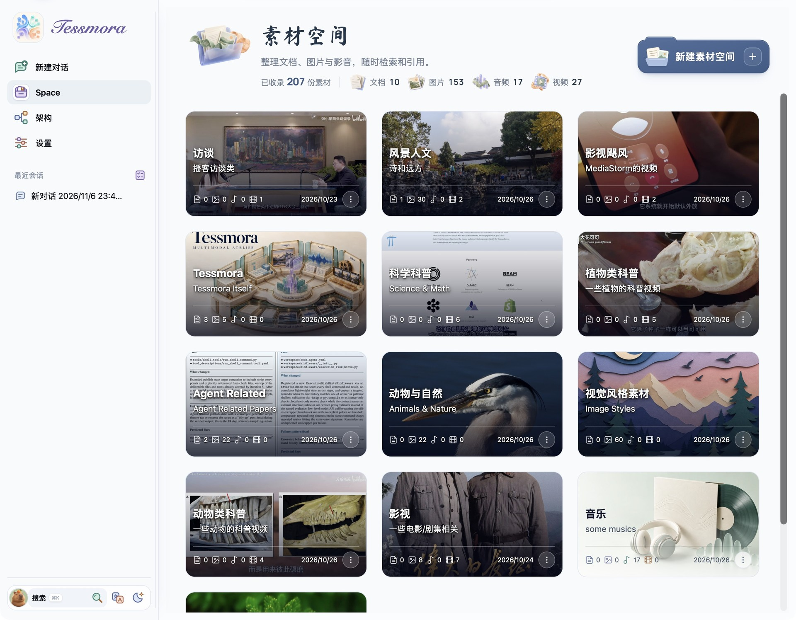
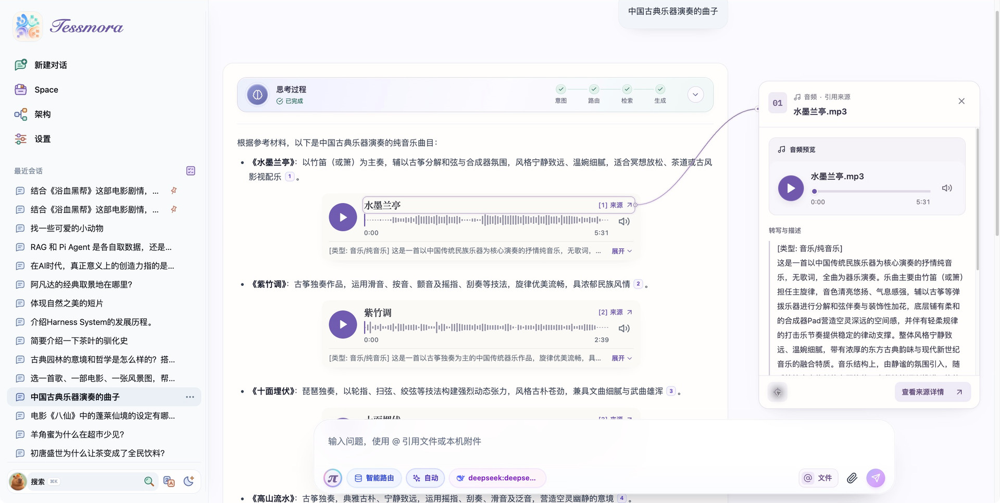
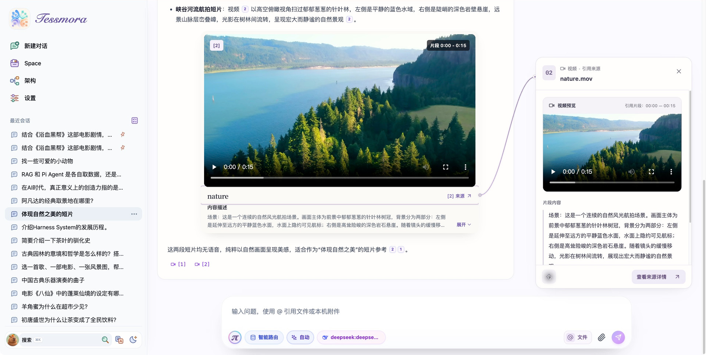
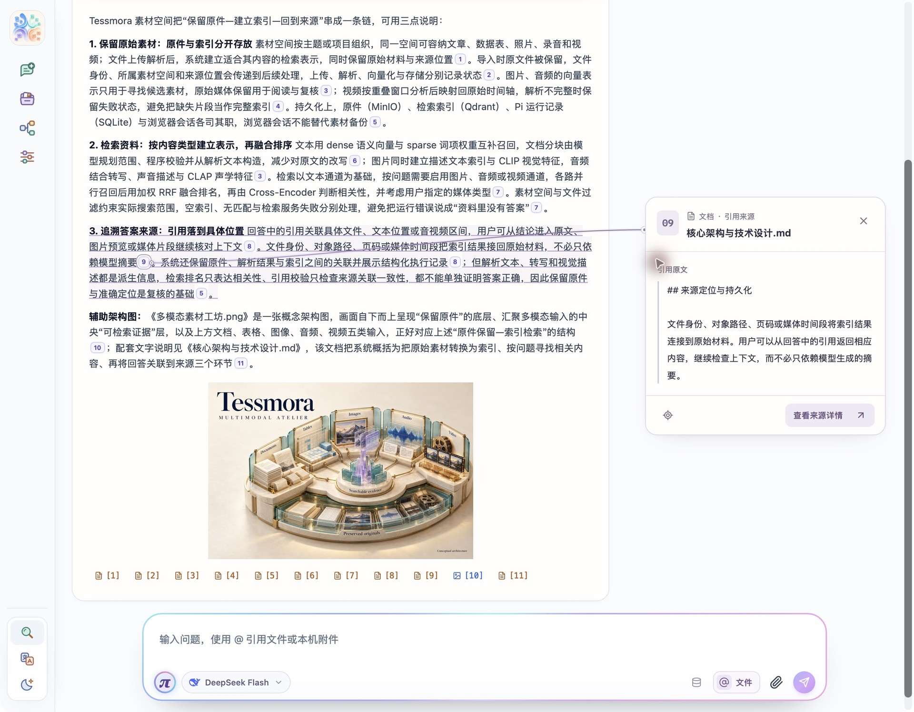
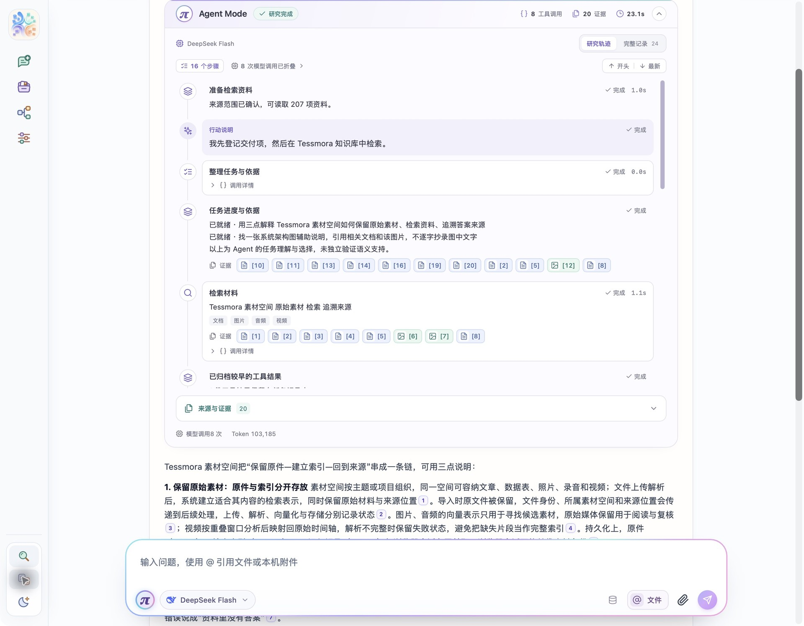
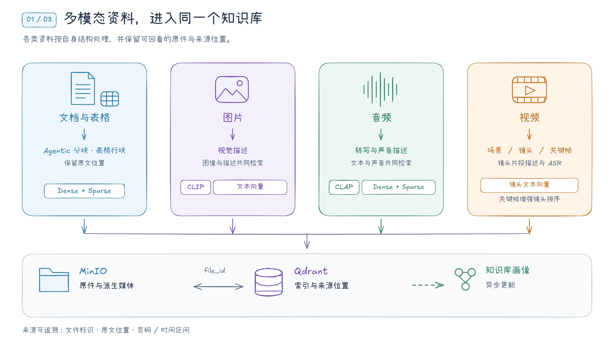
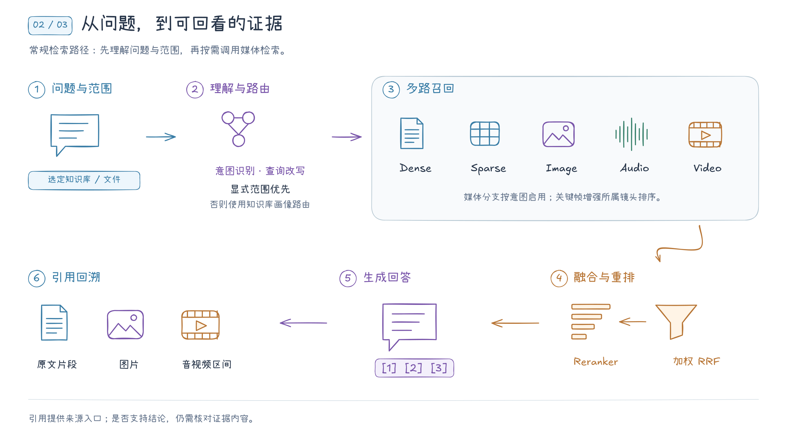
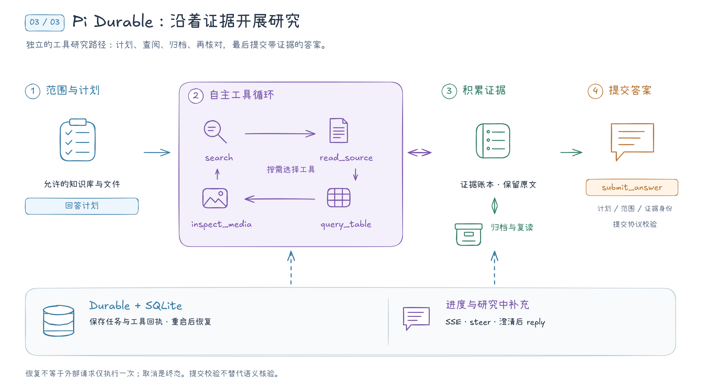

<h1 align="center">
  
</h1>

<p align="center">
  <strong>简体中文</strong> · <a href="README-en.md">English</a>
  <br />
  <a href="#演示">介绍视频</a> · <a href="#交互演示">交互演示</a> · <a href="#快速开始">快速开始</a> · <a href="#agent-mode">Agent Mode</a> · <a href="#架构">架构图解</a> · <a href="#文档">文档</a>
</p>

<p align="center">
  <a href="https://github.com/Champ-X/MMA-RAG/actions/workflows/checks.yml"></a>
  
  
</p>

**Tessmora 是一个可自托管的多模态知识库。** 上传文档、表格、图片或音视频，用自然语言检索。回答中的引用可以打开原文、原图或对应的播放片段。需要比较多份材料时，可以让 Pi 继续查找和阅读。界面支持简体中文和英文。

## 快速开始

本机安装需要 Git、Node.js 22.19 或更高版本、Docker 和 Compose 2.20 或更高版本。Python、FFmpeg 和 LibreOffice 随应用镜像安装。

```bash
git clone --depth 1 --single-branch https://github.com/Champ-X/MMA-RAG.git
cd MMA-RAG
npm --prefix packages/cli ci
node packages/cli/bin/tessmora.js setup --source .
```

向导会让你选择数据目录和所需能力。先试 Markdown 或 TXT 问答，选择文本能力并填写 DeepSeek 和 SiliconFlow 密钥。默认的图片、音频和视频模型还需要阿里云百炼。向导会测试所选模型，按需下载本地权重，随后打开工作区。默认网页端口为 `3001`。

**试一次带引用的问答**

1. 新建知识库，上传仓库中的[示例回滚手册](evals/baseline_v1/corpus/ops-rollback.md)，等待处理完成。
2. 选中这个知识库，用直接检索提问：“什么情况下必须回滚？回滚后如何验证？”
3. 打开回答中的引用。对应段落要求连续三次 `/ready` 检查通过，再观察错误率和 P95 延迟 15 分钟。

日常管理用 `node packages/cli/bin/tessmora.js status`、`stop` 或 `start`。WSL 或无桌面环境可用 `node packages/cli/bin/tessmora.js open --print-url` 取得连接链接，复制到自己的浏览器。链接含实例凭证。注册全局 `tessmora` 命令、恢复安装、升级和备份见[安装器说明](packages/cli/README.md)和[容器分发](docs/DISTRIBUTION.md)。

原件和索引保存在所选数据目录。使用云模型时，相关问题和材料会发送给所选服务商，可能产生费用。默认安装面向本机单用户。共享实例前请阅读[安全说明](SECURITY.md)。

### 从源码开发

如需修改前后端，可在 macOS、Linux 或 WSL2 中从仓库根目录运行以下命令。准备 Python 3.11 或 3.12、Node.js 22.19+ 与 Docker。音视频处理使用 FFmpeg/ffprobe，Office 转换和预览使用 LibreOffice。

```bash
python3.12 -m venv .venv
source .venv/bin/activate
python -m pip install -r backend/requirements.txt
npm --prefix frontend ci
npm --prefix agent-runtime ci
cp -n backend/.env.example backend/.env
```

使用 Python 3.11 时将第一行改为 `python3.11`。编辑 `backend/.env`，填写 `DEEPSEEK_API_KEY`、`SILICONFLOW_API_KEY` 和所用媒体服务的 `ALIYUN_BAILIAN_API_KEY`，清空未使用的示例密钥。示例启用了 BGE-M3、CLIP 和 CLAP 预加载；要推迟到首次使用，可设置 `PRELOAD_LOCAL_MODELS_ON_STARTUP=false`。其他可选路由和服务见[配置示例](backend/.env.example)。

```bash
./start-dev.sh
```

打开 [Web 界面](http://localhost:3001)或[开发 API 文档](http://localhost:8000/docs)。脚本在本机运行 Vite 和 FastAPI，启动或复用 Docker 中的 MinIO、Qdrant 和 Redis。完整安装还运行 Celery worker。后台启动、端口和存储恢复见[本地启动](docs/LOCAL_STARTUP.md)。

## 演示

https://github.com/user-attachments/assets/ba48b505-9b1b-4fd6-9d40-441092cdf8fc

中文介绍，4 分 36 秒。

[中文 MP4](docs/media/tessmora-intro/tessmora-intro-zh.mp4?raw=1) · [English MP4](docs/media/tessmora-intro/tessmora-intro-en.mp4?raw=1) · [中文字幕](docs/media/tessmora-intro/zh.srt) · [媒体文件说明](docs/media/tessmora-intro/README.md)

## 交互演示

这些截图来自同一组已有资料与对话。切换界面语言会翻译控件，保留原始文件名和回答。

### 按主题浏览素材空间

文档、图片和影音文件可放在同一知识库，按类型查看。

[](docs/images/current/knowledge-zh.jpg)

### 查看回答中的图片

“找一些可爱的小动物”返回带来源的图片，可打开原图与描述。

[](docs/images/retrieval/image-search-zh.jpg)

### 试听检索到的音乐

搜索中国古典乐器演奏的曲目后，可在回答中试听《水墨兰亭》和《紫竹调》。

[](docs/images/retrieval/audio-search-zh.jpg)

### 跳到引用的视频片段

查询自然风光短片后，引用会定位到 `nature.mov` 的 00:00–00:15。

[](docs/images/retrieval/video-search-zh.jpg)

<details>
<summary>文件画廊与引用侧栏</summary>

[](docs/images/current/materials-zh.jpg)

[](docs/images/current/citations-zh.jpg)

</details>

[界面截图说明](docs/images/current/README.md) · [检索示例说明](docs/images/retrieval/README.md)

## Agent Mode

| 模式 | 执行方式 |
| --- | --- |
| Direct / Auto / Agent | Direct 执行一轮检索。Agent 先检索原问题，再按预算补查。Auto 根据问题选择两者之一。三者共用常规检索和生成服务。 |
| Pi | 在输入框打开 `π`。Pi 可以搜索、分页读原文、查看图片或媒体片段，也可以筛选、分组和计算表格。知识库和文件选择器限定检索范围，`@` 引用的材料可单独阅读。 |

Pi 默认使用 Durable。运行中可补充要求，在 `needs_input` 时回复澄清，刷新页面后可重新接收事件。宿主重启时会恢复符合条件的未完成任务。运行没有累计时长、Token 或工具调用总额上限，中断的模型请求可能再次计费。展开研究过程可以查看工具调用及其来源。

[](docs/images/current/trace-zh.jpg)

[Pi 工具与配置](docs/PI_AGENT_MODE.md) · [Durable 恢复与回退](docs/pi-agent-durable.md)

## 架构

### 素材入库

MinIO 保存原件与派生文件。Qdrant 存放文本块、图片、音频、视频镜头与关键帧的检索表示，以及知识库画像。

[](docs/diagrams/mma-rag/readme-modules/ingestion-zh.png)

[编辑图表](docs/diagrams/mma-rag/readme-modules/ingestion-zh.excalidraw)

### 常规检索与引用

媒体通道可以融合多种匹配结果。常规重排器合并各通道的候选，去重并排序，供生成器选用。引用将答案连回文件、段落或播放区间。

[](docs/diagrams/mma-rag/readme-modules/retrieval-zh.png)

[编辑图表](docs/diagrams/mma-rag/readme-modules/retrieval-zh.excalidraw)

### Pi 研究任务

Python 宿主限定来源、执行工具并保存账本。独立的 Node 进程运行 Pi 循环，选择工具并生成回答。

[](docs/diagrams/mma-rag/readme-modules/pi-durable-zh.png)

[编辑图表](docs/diagrams/mma-rag/readme-modules/pi-durable-zh.excalidraw)

[系统架构](docs/MMA_ARCHITECTURE.md) · [模块图说明](docs/diagrams/mma-rag/readme-modules/README.md)

<details>
<summary>早期架构总览</summary>

[](docs/diagrams/mma-rag/MMA-RAG-cn-handwritten.svg)

这张图对应 `658b0d1`，早于 Pi Durable 恢复和原生图片、音频检索。 [原始画布](docs/diagrams/mma-rag/MMA-RAG-cn.excalidraw) · [图集](docs/diagrams/mma-rag/README.md)

</details>

## API 与集成

只取证据可以调用 `POST /api/v1/retrieval/search`。将 `KB_ID` 换为实际 ID。响应的 `results` 包含内容、模态、分数和来源，媒体结果可带起止秒数。

```bash
curl -X POST http://localhost:3001/api/v1/retrieval/search \
  -H 'Content-Type: application/json' \
  -d '{"query":"什么情况下必须回滚？","knowledge_base_ids":["KB_ID"],"top_k":5,"language":"zh-CN"}'
```

常规问答使用 `/api/chat/message` 或 `/api/chat/stream`。Pi 通过 `/api/pi/runs` 创建任务，以 `/events` 和 `/inputs` 子路由订阅事件或补充要求。源码开发可以访问 `http://localhost:8000/docs` 查看 OpenAPI。完整 Docker 安装从网页端口代理 `/api/` 与 `/health`。

安装器 `tessmora` 管理实例。知识库命令 `mma-rag` 需要宿主机 Python，可从仓库直接运行，也可用 `./scripts/install-codex-skill.sh` 安装为 Codex Skill。

```bash
export MMA_RAG_BASE_URL=http://localhost:3001
skills/mma-rag/scripts/mma-rag health
skills/mma-rag/scripts/mma-rag kb list
skills/mma-rag/scripts/mma-rag search --query "什么情况下必须回滚？" --kb-id KB_ID
skills/mma-rag/scripts/mma-rag ask --query "总结回滚流程" --kb-id KB_ID --agent-mode auto
```

`ask --agent-mode` 支持 `direct`、`auto` 和 `agent`。飞书 IM 使用 Direct。公开链接和飞书 Docx/Wiki 也可作为知识库导入来源。[CLI 参考](skills/mma-rag/references/cli-reference.md) · [飞书配置](docs/FEISHU_BOT_SETUP.md) · [网络素材采集](docs/NETWORK_COLLECTION.md)

## 文档

从[文档索引](docs/README.md)查找专项指南。改代码或文档前可查[贡献指南](CONTRIBUTING.md)的分项测试命令。[合成评测基线](docs/RAG_EVALUATION.md)提供 7 篇文档和 8 道题，可在本地用 `./scripts/rag-eval validate` 校验输入。版本变更见[更新记录](CHANGELOG.md)。
