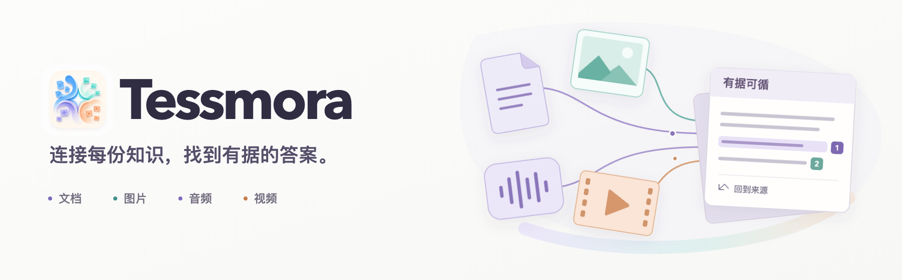
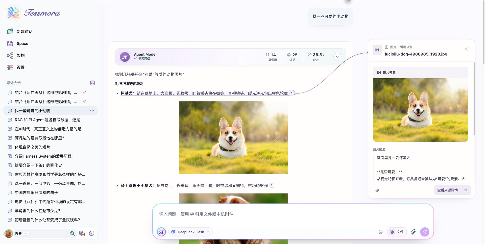
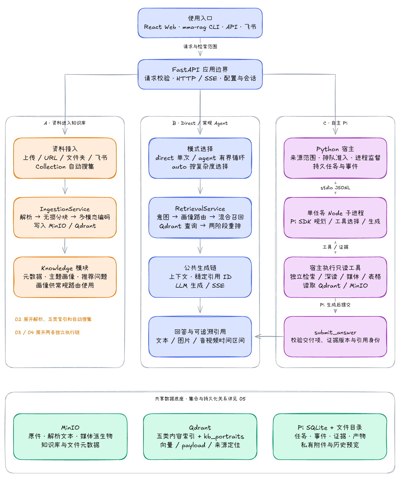

<h1 align="center">
  
</h1>

<p align="center">
  <strong>简体中文</strong> · <a href="README-en.md">English</a>
  <br />
  <a href="#特性">特性</a> · <a href="#快速开始">快速开始</a> · <a href="#从源码开发">开发</a> · <a href="#api">API</a> · <a href="#架构">架构</a> · <a href="#文档">文档</a>
</p>

<p align="center">
  <a href="https://github.com/Champ-X/MMA-RAG/actions/workflows/checks.yml"></a>
  
  
</p>

Tessmora 是一个可自托管的多模态知识库。上传文档、表格、图片、音频或视频，用自然语言检索，并从回答中的引用打开原文、图片或视频片段。

<details open>
<summary>观看项目演示（4 分 36 秒）</summary>

https://github.com/user-attachments/assets/ba48b505-9b1b-4fd6-9d40-441092cdf8fc

[带字幕观看](https://xiangqingping.com/zh/works/tessmora#tessmora-intro) · [下载中文版 MP4](docs/media/tessmora-intro/tessmora-intro-zh.mp4?raw=1) · [中文字幕（SRT）](docs/media/tessmora-intro/zh.srt)

</details>

## 特性

- 支持 PDF、Office、Markdown、纯文本、表格、图片、音频和视频。
- 文档按块检索，图片和独立音频按文件检索，视频结果可定位到具体镜头。
- 常规问答提供 Direct、Auto 和 Agent 三种模式。Pi 可多轮检索、阅读原文和计算表格数据。
- 选择知识库或使用「指定检索文件」限定搜索范围。在输入框中用 `@` 添加本轮要阅读或比较的材料。
- 提供 Web 界面、检索 API、知识库 CLI，以及飞书 IM / Docx / Wiki 接入。
- 支持简体中文和英文界面。

## 快速开始

### 安装要求

- Git
- Docker Engine 或 Docker Desktop
- Compose 2.20+
- Node.js 22.19+

后端镜像包含 Python、FFmpeg 和 LibreOffice。试用下方的文本问答示例，需准备 DeepSeek 和 SiliconFlow 的 API 密钥。

### 安装实例

```bash
git clone --depth 1 --single-branch https://github.com/Champ-X/MMA-RAG.git
cd MMA-RAG
npm --prefix packages/cli ci
node packages/cli/bin/tessmora.js setup --source .
```

在向导中选择「在这台电脑运行」和「文档问答」，按提示设置数据目录、网页端口和密钥。完成后选择打开工作区，向导会用选定的端口和实例凭证连接。

以后可在仓库根目录运行 `node packages/cli/bin/tessmora.js open` 重新打开工作区。在 WSL 或无桌面环境中，可用 `node packages/cli/bin/tessmora.js open --print-url` 打印实例链接，复制到自己的浏览器。该链接含实例凭证，请妥善保管。

**试一次带引用的问答**

1. 新建知识库，上传仓库里的[示例回滚手册](evals/baseline_v1/corpus/ops-rollback.md)，等待索引完成。
2. 在对话中选中该知识库，用 Direct 模式问“什么情况下必须回滚？回滚后如何验证？”
3. 打开回答中关于验证步骤的引用。手册要求连续三次 `/ready` 健康检查通过，再观察错误率和 P95 延迟 15 分钟。

| 日常操作 | 在仓库根目录运行 |
| --- | --- |
| 查看服务和模型状态 | `node packages/cli/bin/tessmora.js status` |
| 停止实例并保留数据 | `node packages/cli/bin/tessmora.js stop` |
| 启动已有实例 | `node packages/cli/bin/tessmora.js start` |

原件和索引保存在所选数据目录。使用云模型时，问题和相关材料可能会发送给服务商并产生费用。共享实例前请阅读[安全说明](SECURITY.md)。升级、备份和排障见[安装器 CLI](packages/cli/README.md)与[容器分发](docs/DISTRIBUTION.md)。

## 从源码开发

在 macOS、Linux 或 WSL2 上，从仓库根目录运行以下命令。需要 Python 3.11 或 3.12、Node.js 22.19+ 和带 Compose 的 Docker。如果使用 Python 3.11，将第一行的 `python3.12` 换成 `python3.11`。

```bash
python3.12 -m venv .venv
source .venv/bin/activate
python -m pip install -r backend/requirements.txt
npm --prefix frontend ci
npm --prefix agent-runtime ci
cp -n backend/.env.example backend/.env
```

在 `backend/.env` 中填写默认文本模型所需的 `DEEPSEEK_API_KEY` 和 `SILICONFLOW_API_KEY`。使用默认图片、音频或视频模型时，再填入 `ALIYUN_BAILIAN_API_KEY`。清空未使用的示例密钥。处理音视频需要在宿主机安装 FFmpeg（含 ffprobe），Office 文件的转换与预览需要 LibreOffice。

```bash
./start-dev.sh
```

默认网页地址为 <http://localhost:3001>。启动器在宿主机运行 Vite 和 FastAPI，在 Docker 中启动或复用 MinIO、Qdrant 和 Redis。开发时如需 Celery worker，可单独启动。端口、后台运行和数据恢复见[本地启动](docs/LOCAL_STARTUP.md)。

## 使用示例

### Agent 模式

| 模式 | 适用场景 |
| --- | --- |
| Direct | 对问题执行一次检索并生成回答。 |
| Agent | 在有限预算内追加检索，适合需要比较多份材料的问题。 |
| Auto | 根据问题自动选择 Direct 或 Agent。 |
| Pi | 打开输入框中的 `π`，让 Agent 搜索、阅读原文、查看媒体片段或处理表格。 |

Pi 默认使用 Durable 运行时，支持运行中补充要求、澄清回复和符合条件的中断恢复。工具调用和证据可在回答中展开查看。详见[Pi 工具与配置](docs/PI_AGENT_MODE.md)。

### 截图

[](docs/images/current/knowledge-zh.jpg)

[](docs/images/retrieval/image-search-zh.jpg)

[](docs/images/retrieval/video-search-zh.jpg)

更多[界面截图](docs/images/current/README.md)和[检索示例](docs/images/retrieval/README.md)。

## API

`POST /api/v1/retrieval/search` 返回检索证据及其来源。可用 `modalities` 筛选返回类型（`doc`、`image`、`audio`、`video`）。将 `KB_ID` 换为实际的知识库 ID。如果使用自定义网页端口，也要替换示例中的 `3001`。

```bash
curl -X POST http://localhost:3001/api/v1/retrieval/search \
  -H 'Content-Type: application/json' \
  -d '{"query":"什么情况下必须回滚？","knowledge_base_ids":["KB_ID"],"top_k":5,"language":"zh-CN"}'
```

- 常规问答使用 `/api/chat/message`，流式回答使用 `/api/chat/stream`。
- 在 `/api/pi/runs` 创建 Pi 任务。用任务的 `/events` 订阅事件，用 `/inputs` 补充要求或回复澄清。

源码开发时可打开 [FastAPI 接口文档](http://localhost:8000/docs)。完整容器安装从网页端口提供 `/api/` 和 `/health`，后端端口 `8000` 位于容器网络内。

也可在仓库根目录运行知识库 CLI。它使用宿主机的 `python3`。`kb list` 可查看示例所需的知识库 ID。

```bash
export MMA_RAG_BASE_URL=http://localhost:3001
skills/mma-rag/scripts/mma-rag health
skills/mma-rag/scripts/mma-rag kb list
skills/mma-rag/scripts/mma-rag search --query "什么情况下必须回滚？" --kb-id KB_ID
skills/mma-rag/scripts/mma-rag ask --query "总结回滚流程" --kb-id KB_ID --agent-mode auto
```

`ask --agent-mode` 支持 `direct`、`auto` 和 `agent`。更多命令见[知识库 CLI 参考](skills/mma-rag/references/cli-reference.md)。

## 架构

完整容器安装用 Nginx 提供网页，FastAPI 处理 API 请求，Pi 研究任务在独立的 Node 进程中运行。MinIO 保存原件和派生文件，Qdrant 保存检索索引。Redis 记录上传进度，Celery worker 执行知识库画像更新等后台任务。

[](docs/diagrams/mma-rag/overview-cn.png)

图为 2026-11-05 的架构快照。当前检索流程和 Pi 任务恢复机制见[系统架构](docs/MMA_ARCHITECTURE.md)。

- [多模态解析与检索技术说明](docs/MULTIMODAL_IMAGE_AUDIO_VIDEO_TECHNICAL_SPEC.md)
- [模块图与可编辑图表](docs/diagrams/mma-rag/readme-modules/README.md)

## 文档

从[文档索引](docs/README.md)按任务查找指南。

| 主题 | 文档 |
| --- | --- |
| 安装、更新、备份 | [安装器 CLI](packages/cli/README.md) · [容器分发](docs/DISTRIBUTION.md) |
| 配置模型和语言 | [模型调用排查](docs/MODEL_CALL_RELIABILITY.md) · [中英文支持](docs/ENGLISH_SUPPORT.md) |
| 飞书与网络导入 | [飞书配置](docs/FEISHU_BOT_SETUP.md) · [网络素材采集](docs/NETWORK_COLLECTION.md) |
| 评测 | [RAG 基线](docs/RAG_EVALUATION.md) · [检索评测](docs/RETRIEVAL_EVALUATION_V2.md) |
| 参与贡献 | [贡献指南](CONTRIBUTING.md) · [安全说明](SECURITY.md) |
| 版本记录 | [CHANGELOG](CHANGELOG.md) |
