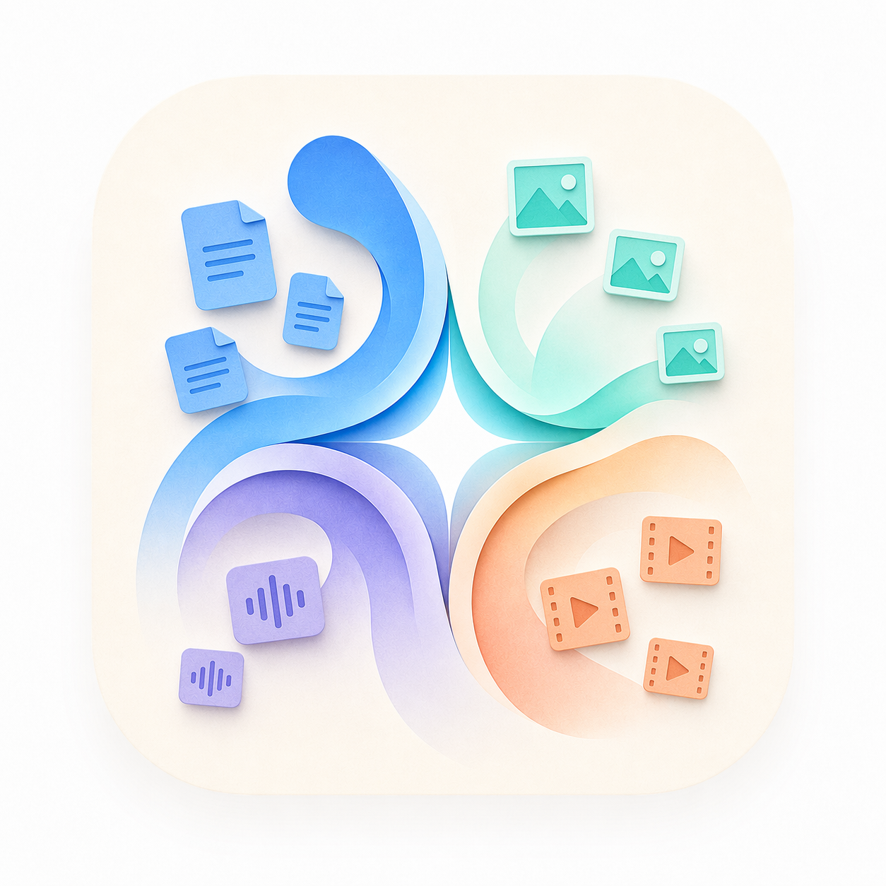
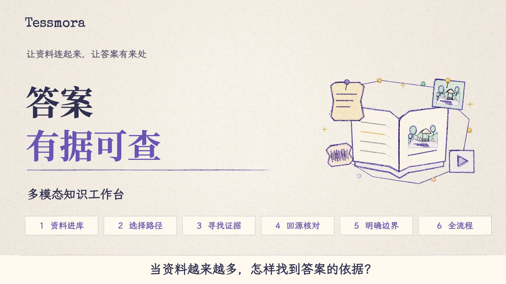
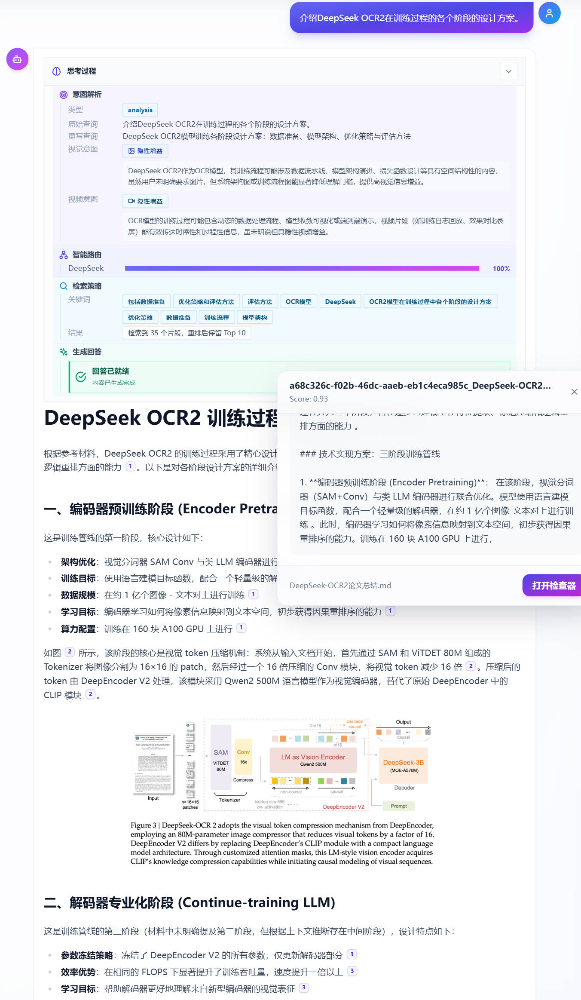
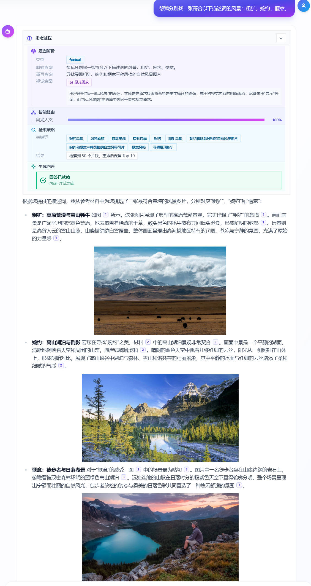
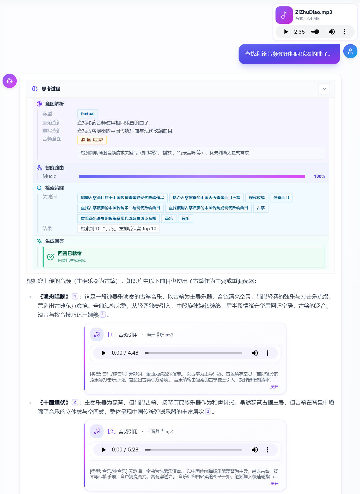
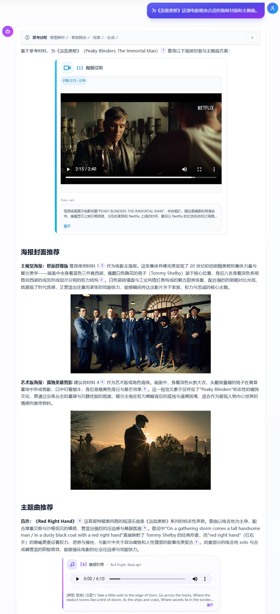
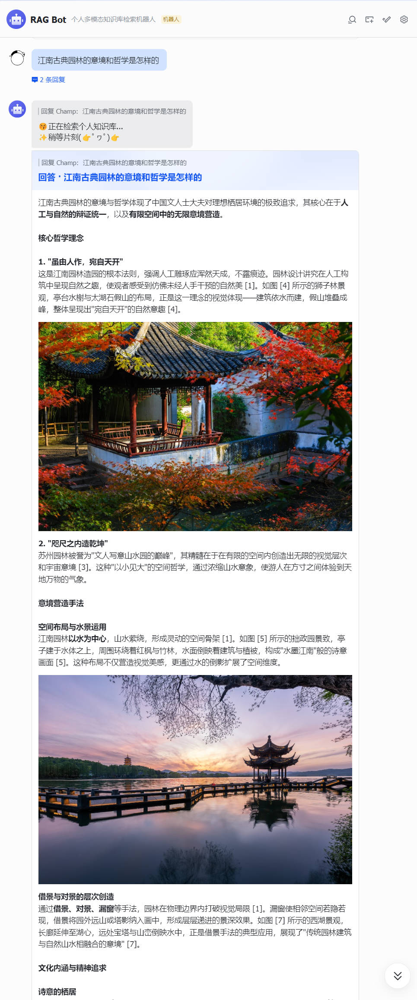
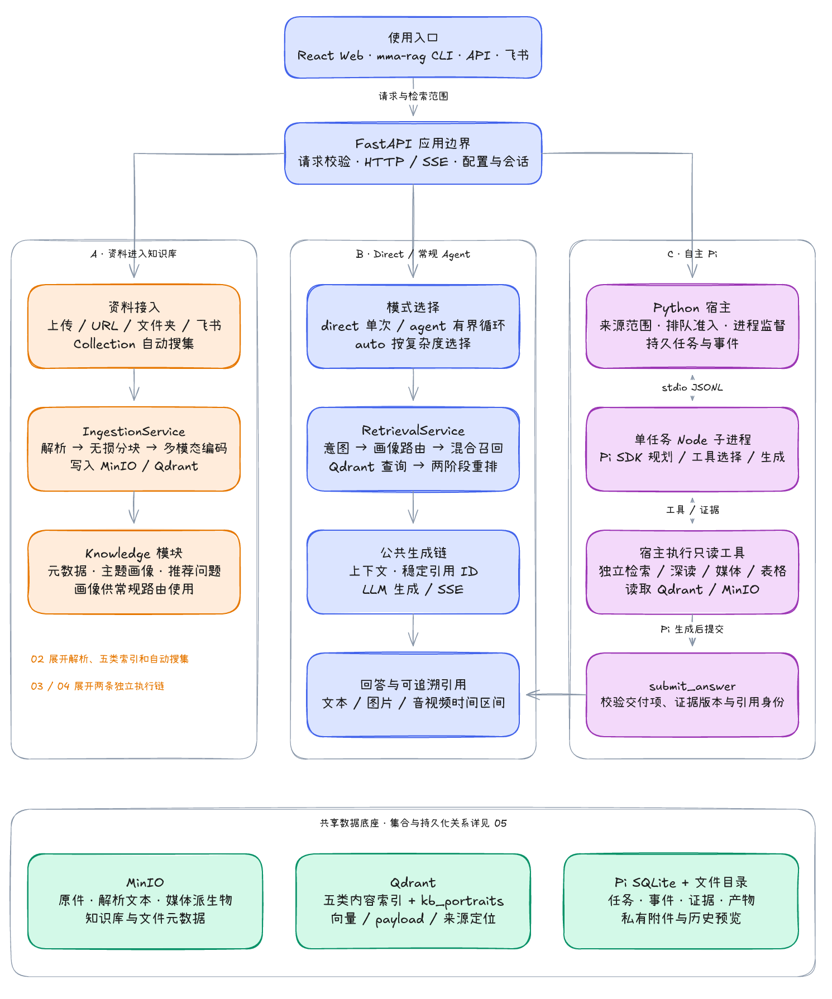

<p align="center">
  
</p>

<h1 align="center">Tessmora</h1>

<p align="center"><strong>把散落的资料，变成有据可查的答案。</strong></p>
<p align="center">Every fragment finds its place.</p>

<p align="center">
  <strong>简体中文</strong> · <a href="README-en.md">English</a>
</p>

<p align="center">
  <a href="#演示">演示</a> ·
  <a href="#快速开始">快速开始</a> ·
  <a href="#agent-mode">Agent Mode</a> ·
  <a href="#架构">架构</a> ·
  <a href="#文档">文档</a>
</p>

<p align="center">
  <a href="https://github.com/Champ-X/MMA-RAG/actions/workflows/checks.yml"></a>
  
  
</p>

**Tessmora 是可自托管的多模态知识库与 Agent 研究工作台。** 将文档、表格、图片、音频和视频放在一起，用自然语言搜索、比较和提问，再沿着引用回到原文、图片或媒体时间片段核对答案。

它适合阅读一组研究资料、在素材库里寻找画面与音乐，也适合让 Agent 围绕复杂问题逐步搜索、深读和整理证据。Web 界面支持简体中文与 English。仓库沿用 `MMA-RAG` 名称。

## 演示

[](docs/media/tessmora-intro/tessmora-intro-zh.mp4?raw=1)

**点击封面打开视频** · 4 分 36 秒 · 720p · 约 21 MiB

[中文 MP4](docs/media/tessmora-intro/tessmora-intro-zh.mp4?raw=1) · [English MP4](docs/media/tessmora-intro/tessmora-intro-en.mp4?raw=1) · [中文字幕](docs/media/tessmora-intro/zh.srt) · [媒体文件说明](docs/media/tessmora-intro/README.md)

## 你可以用它做什么

| 工作流 | 实际能力 |
| --- | --- |
| **收集与管理资料** | 上传本地文件，或从公开链接与已配置的网络渠道发现素材；预览候选后收录，跟踪下载、解析与索引进度 |
| **跨模态搜索** | 结合 Dense、BGE-M3 Sparse、CLIP、CLAP 等检索通道，按问题意图融合召回并重排；未指定知识库时可按主题画像路由 |
| **围绕问题深入研究** | Pi 自主搜索、分页阅读原文、扩展上下文、观察媒体、计算表格；运行中可补充要求，澄清后继续原任务 |
| **核对每一处来源** | 回答引用关联原文件、文本上下文、图片及音视频时间范围；过程面板展示实际工具调用、证据、耗时与异常 |
| **控制材料与范围** | 用 `@` 引用文件或本机附件作为分析材料，用知识库与文件选择器限定搜索范围；材料引用不会自动扩大检索范围 |
| **接入自己的工作流** | 中英文 Web UI、检索与对话 API、安装管理 CLI、知识库 CLI / Codex Skill，以及可选的飞书 IM 与 Docx/Wiki 导入 |

<details>
<summary><strong>查看交互截图：文档、图片、音频、视频与飞书</strong></summary>

以下是已有的中文 Web / 飞书交互示例，展示检索结果和媒体引用；Pi 的当前行为见 [Agent Mode](#agent-mode)。

**文档问答** — “介绍 DeepSeek OCR2 在训练过程各阶段的设计方案。”



**图片检索** — “分别找一张符合粗犷、婉约、惬意的风景图。”



**音频检索** — “查找和该音频使用相同乐器的曲子。”



**视频问答** — “《让子弹飞》中汤师爷的人物性格是怎样的？”


**跨模态选材** — “为《浴血黑帮》挑选合适的海报封面和主题曲。”



**飞书 IM** — 在已有沟通工具中提问和查看媒体引用。



</details>

## 快速开始

### 安装到本机

推荐首次使用 **终端向导 + 完整 Docker 安装**。准备 Node.js **22.19+**、Docker 与 Compose **2.20+**；应用所需的 Python、FFmpeg 等依赖由容器提供。Docker 尚未就绪时，向导会提供安装入口和重新检测步骤。

```bash
git clone --depth 1 --single-branch https://github.com/Champ-X/MMA-RAG.git
cd MMA-RAG
npm --prefix packages/cli ci
node packages/cli/bin/tessmora.js setup --source .
```

向导会选择能力、数据目录与模型服务，构建并启动应用和存储，实际验证模型连接，再按需准备本地模型。默认 Web 地址为 **http://localhost:3001**；请使用向导打开的页面完成工作区连接。端口冲突时可另选端口，中途退出后可重新运行同一命令继续。

先体验 Markdown / TXT 问答，可选择文本能力并配置 DeepSeek 与 SiliconFlow；默认图片、音频、视频能力还需要阿里云百炼。首次构建和模型下载需要时间、磁盘与内存；向导会显示进度和日志。

**数据与模型：** 原文件、索引和运行记录保存在所选数据目录。默认解析和推理会调用配置的模型服务商，可能传出内容并产生费用；自托管不意味着离线推理。应用目前面向本机单用户与可信网络，公网部署前请阅读 [安全说明](SECURITY.md)。

<details>
<summary>日常管理、命令注册与 WSL 打开方式</summary>

```bash
node packages/cli/bin/tessmora.js status
node packages/cli/bin/tessmora.js stop
node packages/cli/bin/tessmora.js start
node packages/cli/bin/tessmora.js doctor
```

可执行 `npm --prefix packages/cli run register-command` 注册 `tessmora` 命令，再用 `tessmora --version` 验证。未注册或 PATH 未生效时，继续使用上面的 Node 入口。

WSL / 无桌面环境不能自动打开网页时，执行 `node packages/cli/bin/tessmora.js open --print-url`，将输出的完整链接粘贴到浏览器。链接包含当前实例的连接凭证，仅供自己使用。

本文使用源码构建入口。打包安装、配置变更、远程连接与完整数据备份见 [安装器说明](packages/cli/README.md) 和 [容器分发](docs/DISTRIBUTION.md)。

</details>

### 完成第一次有引用的问答

1. 打开 Web UI，创建一个知识库。
2. 上传自己的文档，或使用合成示例 [`ops-rollback.md`](evals/baseline_v1/corpus/ops-rollback.md)，等待处理完成。
3. 选择该知识库，以“直接检索”提问：**“什么情况下必须回滚？回滚后如何验证？”**
4. 打开引用，核对原文中的触发条件、三次 `/ready` 检查与 15 分钟观察期。
5. 打开输入框左侧的 `π`，尝试深入研究；展开过程查看使用了哪些来源和工具。

API 健康检查通过只说明服务已启动；完成上传、检索和引用核对，才能确认所用链路可用。

### 从源码开发

本机运行前后端，Docker 提供存储。macOS / Linux 可直接使用下列命令，Windows 可使用 WSL2。

<details>
<summary><strong>展开开发环境、模型配置与启动命令</strong></summary>

需要 Python **3.11 / 3.12**、Node.js **≥22.19**、Docker / Compose。音视频处理需要 **FFmpeg / ffprobe**；DOCX/PPTX 转换与预览需要 **LibreOffice**，Linux 中文文档建议安装 `fonts-noto-cjk`。

在已克隆的仓库根目录执行：

```bash
cp backend/.env.example backend/.env
```

编辑 `backend/.env`，填入实际凭证并清空未使用服务的 `your_...` 占位值。当前默认路由为：

| 环境变量 | 用途 |
| --- | --- |
| `DEEPSEEK_API_KEY` | 文本问答、意图识别、文档分块与 Pi 主模型：`deepseek-flash` |
| `SILICONFLOW_API_KEY` | 文本向量化与重排：Qwen3 Embedding / Reranker |
| `ALIYUN_BAILIAN_API_KEY` | 图片理解、音频转写、视频解析与 Pi 媒体观察 |
| `MINERU_TOKEN` | 可选的 MinerU 云端文档解析；其他解析路径取决于文件类型和依赖 |
| `OPENROUTER_API_KEY` | 可选，选择 OpenRouter 模型时使用 |

常规模型路由可在设置中调整；Pi 使用 [独立配置](docs/PI_AGENT_MODE.md)。网络采集与飞书等可选服务见 [环境变量示例](backend/.env.example)。

```bash
python3.12 -m venv .venv
source .venv/bin/activate
python -m pip install --upgrade pip
python -m pip install -r backend/requirements.txt
npm --prefix frontend ci
npm --prefix agent-runtime ci
./start-dev.sh
```

使用 Python 3.11 时替换第一行的版本号。脚本优先使用 `.venv`（可用 `MMA_PYTHON` 指定），检查运行时与依赖，从根 Compose 中启动或复用 MinIO / Qdrant / Redis，并等待 API 与前端代理就绪。Celery worker / Flower 不在此启动路径中；完整容器安装使用独立的 `deploy/compose.yaml`。

示例配置开启本地模型预加载，首次可能下载 BGE-M3、CLIP、CLAP。设置 `PRELOAD_LOCAL_MODELS_ON_STARTUP=false` 可推迟到首次使用，不会消除模型依赖。

```bash
./start-dev.sh                       # 前台运行，Ctrl+C 停止前后端
./start-dev.sh restart --background  # 重启并后台运行
./start-dev.sh status                # 进程、API 与前端代理状态
./start-dev.sh logs                  # 最近日志
./start-dev.sh stop                  # 停止应用，保留存储容器
./start-dev.sh doctor                # 只检查环境
```

| 源码开发入口 | 默认地址 |
| --- | --- |
| Web UI | [localhost:3001](http://localhost:3001) |
| API / OpenAPI | [localhost:8000/docs](http://localhost:8000/docs) |
| 健康检查 | [localhost:8000/health](http://localhost:8000/health) |
| MinIO Console | [localhost:9001](http://localhost:9001) |
| Qdrant Dashboard | [localhost:6333/dashboard](http://localhost:6333/dashboard) |

前端默认 3001，可通过 `--port` / `FRONTEND_PORT` 修改；后端固定 8000。开发后端可加 `--reload`。端口占用、模型下载、媒体访问与已有数据恢复见 [本地启动说明](docs/LOCAL_STARTUP.md)。

</details>

## Agent Mode

同一会话可以切换两条独立的问答路径：

| 路径 | 适合什么 | 工作方式 |
| --- | --- | --- |
| **常规检索** | 快速查找资料、针对已知范围提问 | `direct` 单轮检索；`agent` 在轮数、查询数与证据预算内补查；`auto` 自动选择 |
| **Pi Agent** | 需要反复搜索、深读、比较与媒体观察的研究 | 独立 Pi 循环选择工具、维护研究计划、收集证据并提交带引用的回答；Web 输入框 `π` 开启 |

Pi 能阅读长文、扩展相邻片段、恢复已读证据、观察图片/PDF 页/音视频片段，并对 CSV/TSV/XLSX 做确定性的筛选、分组和计算。它复用知识数据，但使用独立搜索编排；可按需增加图片 CLIP / 音频 CLAP 召回。网络素材收集是单独的入库功能，Pi 的来源工具不提供任意 Shell、代码执行或自动网络抓取。

**研究可以继续。** 默认的 Pi Durable 运行时保存任务、事件和证据，支持运行中补充要求、在 `needs_input` 时回复澄清、刷新后续接事件，以及服务重启后恢复符合条件的未完成任务。显式停止或删除会话会取消任务；更换模型、材料或搜索范围需要新任务。`core` 兼容模式不提供同样的执行恢复。

**边界也可见。** Pi 没有应用层累计时长、Token 或工具调用总量上限；用户可停止，无进展和异常保护仍会终止运行。恢复中断的模型请求可能产生额外费用。引用校验检查来源身份与编号，不保证语义正确；视频观察是采样，不是逐帧观看。

[工具与配置](docs/PI_AGENT_MODE.md) · [Durable 恢复、持续输入与已知限制](docs/pi-agent-durable.md)

## 架构

[](docs/diagrams/mma-rag/MMA-RAG-cn-handwritten.svg)

[查看完整中文架构图](docs/diagrams/mma-rag/MMA-RAG-cn-handwritten.svg) · [高清 PNG](docs/diagrams/mma-rag/MMA-RAG-cn-handwritten.png) · [可编辑 Excalidraw](docs/diagrams/mma-rag/MMA-RAG-cn.excalidraw) · [双语图集](docs/diagrams/mma-rag/README.md)

预览截取自 **2026-11-05 / `658b0d1`** 的手写架构图。完整图中的 Pi 重启行为与原生图片/音频检索说明早于 Durable 更新；当前行为以本页和 [系统架构](docs/MMA_ARCHITECTURE.md) 为准。

当前数据流可以概括为：

1. **入库**：按模态解析；文档保留原文分块，表格保留表头与行块，媒体保存描述、转写和时间定位。原文件存入 MinIO，向量与索引存入 Qdrant。
2. **问答**：React / TypeScript 前端调用 FastAPI；常规检索走混合召回与重排，Pi 由 Python 宿主和独立 Node 工作进程组织研究。
3. **核验与续跑**：回答绑定来源引用；Pi 在本地 SQLite 中保存运行账本和 Durable 会话，Redis 支持任务与缓存等基础设施。

| 源码入口 | 职责 |
| --- | --- |
| [`frontend/`](frontend/) | 知识库、对话、媒体引用、研究过程与中英文界面 |
| [`ingestion/`](backend/app/modules/ingestion/) · [`collection/`](backend/app/modules/collection/) | 文件解析、多模态索引与网络素材收集 |
| [`retrieval/`](backend/app/modules/retrieval/) · [`agent/`](backend/app/modules/agent/) · [`generation/`](backend/app/modules/generation/) | 常规检索、有界多轮补查与回答生成 |
| [`pi_agent/`](backend/app/modules/pi_agent/) · [`agent-runtime/`](agent-runtime/) | Pi 宿主、来源工具、运行账本与 Durable 循环 |
| [`core/llm/`](backend/app/core/llm/) · [`packages/cli/`](packages/cli/) | 模型服务与任务路由、安装和实例管理 |

## API 与集成

使用只读检索 API 获取 `doc | image | audio | video` 证据。将 `KB_ID` 替换为实际知识库 ID；以下使用两种安装方式均提供的 Web 代理，端口以实际配置为准：

```bash
curl -X POST http://localhost:3001/api/v1/retrieval/search \
  -H 'Content-Type: application/json' \
  -d '{"query":"什么情况下必须回滚？","knowledge_base_ids":["KB_ID"],"top_k":5,"language":"zh-CN"}'
```

常规对话使用 `/api/chat/message` 或 `/api/chat/stream`；Pi 使用 `/api/pi/runs` 创建任务，`/api/pi/runs/{run_id}/events` 订阅过程，`/api/pi/runs/{run_id}/inputs` 补充输入。Pi 有独立的访问控制，配置见 [Pi 文档](docs/PI_AGENT_MODE.md)。源码开发还可直连 8000，并通过 [OpenAPI](http://localhost:8000/docs) 查看请求结构；完整 Docker 安装默认不发布 8000 或 OpenAPI 页面。

`tessmora` 管理安装与服务；仓库自带的 **`mma-rag`** 操作知识库、检索与问答。后者需要宿主机 Python，可直接运行或通过 `./scripts/install-codex-skill.sh` 安装为 Codex Skill：

```bash
export MMA_RAG_BASE_URL=http://localhost:8000  # 源码开发；完整 Docker 安装改为 http://localhost:3001
skills/mma-rag/scripts/mma-rag health
skills/mma-rag/scripts/mma-rag kb list
skills/mma-rag/scripts/mma-rag search --query "什么情况下必须回滚？" --kb-id KB_ID
skills/mma-rag/scripts/mma-rag ask --query "总结回滚流程" --kb-id KB_ID --agent-mode auto
```

CLI 的 `--agent-mode` 选择常规 `direct / auto / agent`，不启用 Pi。飞书 IM 当前走直接检索。详见 [CLI 参考](skills/mma-rag/references/cli-reference.md) 与 [飞书接入](docs/FEISHU_BOT_SETUP.md)。

## 开发与验证

安装开发依赖后，从仓库根目录运行：

```bash
python3 scripts/check_repository.py
python3 scripts/test_dev.py
npm --prefix frontend test
npm --prefix frontend run test:dom
npm --prefix frontend run build
npm --prefix agent-runtime test
npm --prefix packages/cli test
./scripts/rag-eval validate
```

CI 覆盖仓库规则、启动控制器、前端测试/构建、Pi 与安装器回归。后端测试的服务前提见 [贡献指南](CONTRIBUTING.md)。真实模型、真实语料和浏览器验收需要单独执行，构建或健康检查不能替代它们。

快速评测使用 **7 份合成文档 / 8 个问题**，用于回归检查，不代表通用质量。公开语料、自有知识库与 Pi 对比工具见 [RAG 评测](docs/RAG_EVALUATION.md)、[检索评测](docs/RETRIEVAL_EVALUATION_V2.md) 和 [Pi 评测边界](docs/pi-agent-durable.md#对比评测与已知问题)。

## 部署边界

- **单用户与可信网络**：尚无完整用户鉴权、租户隔离与知识库 ACL；常规 API 的 CORS 允许任意来源。Pi / 安装器令牌不替代应用级权限体系，公网访问需要额外保护，见 [SECURITY.md](SECURITY.md)。
- **单写者与备份**：Pi 数据目录仅允许一个宿主持锁；请备份完整运行目录。常规后端会话与部分统计仍在进程内，不能直接横向扩为无状态多副本。
- **能力与质量**：Pi Durable 上游仍为 Experimental；Pi 暂不支持原生视频向量通道，也没有已上线的语义蕴含验证器。媒体采样、检索结果与模型结论都应结合原文件核对。

## 文档

| 我想…… | 阅读 |
| --- | --- |
| 安装、升级、备份或排查启动 | [安装器](packages/cli/README.md) · [容器分发](docs/DISTRIBUTION.md) · [本地启动](docs/LOCAL_STARTUP.md) |
| 理解架构与多模态处理 | [系统架构](docs/MMA_ARCHITECTURE.md) · [多模态技术说明](docs/MULTIMODAL_IMAGE_AUDIO_VIDEO_TECHNICAL_SPEC.md) · [手写图集](docs/diagrams/mma-rag/README.md) |
| 配置 Pi、恢复任务或核对执行边界 | [Pi Agent](docs/PI_AGENT_MODE.md) · [Pi Durable](docs/pi-agent-durable.md) · [Decision 模型](docs/DECISION_MODELS.md) |
| 调整语言、模型与附件行为 | [英语支持](docs/ENGLISH_SUPPORT.md) · [模型排查](docs/MODEL_CALL_RELIABILITY.md) · [引用与附件](docs/chat-inline-references.md) |
| 查找其余资料 | [文档导航](docs/README.md) · [变更记录](CHANGELOG.md) · [仓库维护](docs/REPOSITORY.md) |

## 参与贡献

欢迎通过 [Issues](https://github.com/Champ-X/MMA-RAG/issues) 反馈问题，通过 [Pull Requests](https://github.com/Champ-X/MMA-RAG/pulls) 提交修改，中文和英文均可。

- 报告问题时附提交 SHA、环境、使用模式、最小复现和脱敏日志。
- 修改聚焦一个问题，说明验证结果；界面改动附截图，检索改动附可复现输入与来源。
- 文档变更同步中英文 README，不将实验候选写成已交付能力。
- 不提交密钥、用户知识库或未脱敏运行记录；安全问题按 [安全报告流程](SECURITY.md#reporting) 处理。

详细流程见 [CONTRIBUTING.md](CONTRIBUTING.md)。

## 许可证

当前仓库未提供 `LICENSE`，也未声明开源许可证。使用、修改或分发的授权范围请与维护者确认。

## 致谢

感谢 [Pi](https://github.com/earendil-works/pi)、[Qdrant](https://github.com/qdrant/qdrant)、[MinIO](https://github.com/minio/minio)、[FlagEmbedding](https://github.com/FlagOpen/FlagEmbedding)、[CLIP](https://github.com/openai/CLIP)、[CLAP](https://github.com/LAION-AI/CLAP)、[FastAPI](https://github.com/fastapi/fastapi) 与 [React](https://github.com/facebook/react) 等项目的维护者和贡献者。
